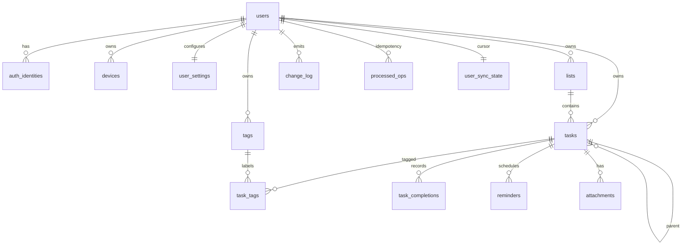

# 待办事项管理 App 数据库设计

| 项目 | 内容 |
| --- | --- |
| 文档版本 | v1.0 |
| 日期 | 2026-11-01 |
| 状态 | 详细设计基线 |
| 目标数据库 | MySQL 8.0+（当前 Spring Boot 实现） |
| 上游文档 | [`todo-app-design.md`](todo-app-design.md)、[`requirements.md`](requirements.md) |
| 机器可执行 DDL | [`sql/001_init.mysql.sql`](sql/001_init.mysql.sql)（当前实现） |

> **实现说明（2026-11-02）**：后端已按最新要求切换为 Spring Boot 3 + JDK 17 + MySQL 8 + MyBatis-Plus（XML）；
> 当前可执行 DDL 为 [`sql/001_init.mysql.sql`](sql/001_init.mysql.sql)，实现代码见 [`backend/`](../backend/)。
> 下文保留原 PostgreSQL 设计基线（字段、约束、事务语义仍具参考价值）；schema 前缀在 MySQL 中映射为表名前缀，
> `sync.*` 的函数改为应用层事务/行锁实现，Redis OTP 改为 MySQL 表。

## 1. 设计约定

### 1.1 基本规则

- **主键**：UUID，由客户端/服务端生成 UUIDv7；离线创建无需数据库分配。
- **时间**：`timestamptz` 存 UTC；`due_date` 是用户本地日历日期，不做时区换算。
- **软删除**：`deleted_at` 墓碑；回收站 30 天；硬清理由后台任务执行。
- **并发**：实体 `version bigint` 由服务端递增；客户端带 `baseVersion` 或 `If-Match`。
- **多租户**：所有业务表带 `user_id`；复合外键保证任务/清单/标签同属一个用户。
- **同步序号**：`sync.user_sync_state.current_seq` 每用户递增；`sync.change_log` 记录变更；`sync.processed_ops` 幂等。
- **服务端专用表**：`todo.task_completions`、`notify.reminders`、`sync.*` 不参与客户端同步；客户端通过任务字段和 API 获取结果。
- **不存敏感内容到日志**：数据库可存任务标题/备注；应用日志不记录。

### 1.2 Schema 划分

| Schema | 职责 |
| --- | --- |
| identity | 用户、第三方身份、设备、刷新令牌、用户设置 |
| todo | 清单、任务、标签、关联、完成台账、附件元数据 |
| notify | 提醒物化与调度状态 |
| sync | 每用户序号、变更日志、幂等记录 |
| ops | 导出任务、审计日志 |

### 1.3 通用字段

| 字段 | 类型 | 规则 |
| --- | --- | --- |
| id | uuid | UUIDv7；客户端离线生成 |
| user_id | uuid | 外键 identity.users；所有查询必须带 |
| version | bigint | 初始 1；每次写 +1；`CHECK (version > 0)` |
| created_at | timestamptz | 默认 now() |
| updated_at | timestamptz | 触发器更新 |
| deleted_at | timestamptz | NULL = 未删除；软删除时间 |

## 2. ER 图



## 3. 表与字段

### 3.1 identity.users

用途：用户主表；保存邮箱、显示名、时区、语言、令牌版本。

| 字段 | 类型 | 空 | 默认 | 说明 |
| --- | --- | --- | --- | --- |
| id | uuid | 否 | — | PK |
| email | citext | 否 | — | 大小写不敏感；未删除时唯一 |
| display_name | text | 否 | — | 1–50 字符 |
| avatar | text | 是 | NULL | 预置头像 ID 或 URL |
| timezone | text | 否 | 'UTC' | IANA 时区 |
| locale | text | 否 | 'zh-CN' | `zh-CN` / `en` |
| auth_version | bigint | 否 | 1 | 令牌版本；撤销时 +1 |
| created_at | timestamptz | 否 | now() | |
| updated_at | timestamptz | 否 | now() | 触发器 |
| deleted_at | timestamptz | 是 | NULL | 注销后软删 30 天 |

索引/约束：

- `users_email_active`：`UNIQUE (email) WHERE deleted_at IS NULL`；
- `auth_version > 0`。

### 3.2 identity.auth_identities

用途：Apple/Google/邮箱身份绑定。

| 字段 | 类型 | 空 | 说明 |
| --- | --- | --- | --- |
| id | uuid | 否 | PK |
| user_id | uuid | 否 | FK users，级联删除 |
| provider | text | 否 | `apple` / `google` / `email` |
| provider_user_id | text | 否 | 第三方唯一 ID |
| created_at | timestamptz | 否 | |

约束：`UNIQUE (provider, provider_user_id)`；用户索引。

### 3.3 identity.devices

用途：设备、推送 token、设备级令牌版本。

| 字段 | 类型 | 空 | 默认 | 说明 |
| --- | --- | --- | --- | --- |
| id | uuid | 否 | — | PK |
| user_id | uuid | 否 | — | FK users |
| name | text | 否 | — | 1–100 字符 |
| platform | text | 否 | — | ios / android / web |
| app_version | text | 是 | NULL | 例如 1.0.0 |
| os_version | text | 是 | NULL | |
| push_token | text | 是 | NULL | APNs/FCM/厂商 token |
| push_provider | text | 是 | NULL | apns/fcm/expo/国内厂商 |
| auth_version | bigint | 否 | 1 | 设备级撤销版本 |
| last_seen_at | timestamptz | 否 | now() | |
| revoked_at | timestamptz | 是 | NULL | 移除设备时间 |
| created_at / updated_at | timestamptz | 否 | now() | |

索引：`(user_id, revoked_at)`；活跃 push token 部分索引。

### 3.4 identity.refresh_tokens

用途：刷新令牌轮换与重放检测；只存哈希。

| 字段 | 类型 | 空 | 说明 |
| --- | --- | --- | --- |
| id | uuid | 否 | PK |
| user_id | uuid | 否 | FK users |
| device_id | uuid | 否 | FK devices |
| family_id | uuid | 否 | 同一条轮换链共享 |
| replaced_by_id | uuid | 是 | 轮换后的新令牌；自引用 |
| token_hash | text | 否 | SHA-256 hex，唯一 |
| expires_at | timestamptz | 否 | 30 天 |
| rotated_at | timestamptz | 是 | 已轮换时间 |
| revoked_at | timestamptz | 是 | 撤销时间 |
| created_at | timestamptz | 否 | |

索引：`(family_id)`、`(user_id, expires_at)`。

### 3.5 identity.user_settings

用途：服务端与客户端共享的偏好；服务端读取默认提醒时间。

| 字段 | 类型 | 空 | 默认 | 说明 |
| --- | --- | --- | --- | --- |
| user_id | uuid | 否 | — | PK / FK users |
| theme | text | 否 | 'system' | system/light/dark |
| accent | text | 否 | 'coral' | coral/teal/amber/indigo |
| week_start | text | 否 | 'monday' | monday/sunday |
| default_list_id | uuid | 是 | NULL | 复合 FK lists；可空 |
| default_reminder_time | time | 否 | '09:00' | 全天提醒基准 |
| time_format | text | 否 | '24h' | 12h/24h |
| quiet_hours_start / end | time | 是 | NULL | 成对出现 |
| notification_prefs | jsonb | 否 | '{}' | 类型开关 |
| version | bigint | 否 | 1 | |
| updated_at | timestamptz | 否 | now() | |

### 3.6 todo.lists

用途：收件箱与自定义清单。

| 字段 | 类型 | 空 | 默认 | 说明 |
| --- | --- | --- | --- | --- |
| id | uuid | 否 | — | PK |
| user_id | uuid | 否 | — | FK users |
| name | text | 否 | — | 1–50 字符 |
| color | text | 否 | 'coral' | 颜色 ID |
| icon | text | 否 | 'list' | 图标 ID |
| sort_rank | text | 否 | — | 分数索引 |
| is_archived | boolean | 否 | false | 归档 |
| is_default | boolean | 否 | false | 收件箱 |
| version | bigint | 否 | 1 | |
| created_at / updated_at / deleted_at | timestamptz | 否/否/是 | | |

索引/约束：

- `UNIQUE (user_id, id)`（复合外键需要）；
- `lists_one_default`：`UNIQUE (user_id) WHERE is_default AND deleted_at IS NULL`；
- `(user_id, sort_rank) WHERE deleted_at IS NULL`。

### 3.7 todo.tasks

用途：任务主表；一次性任务与重复任务当前实例共用一行。

| 字段 | 类型 | 空 | 默认 | 说明 |
| --- | --- | --- | --- | --- |
| id | uuid | 否 | — | PK；客户端生成 |
| user_id | uuid | 否 | — | FK users |
| list_id | uuid | 否 | — | 复合 FK lists |
| parent_id | uuid | 是 | NULL | 复合 FK tasks；仅 1 层 |
| title | text | 否 | — | 1–500 字符（btrim 后） |
| notes | text | 否 | '' | ≤10,000 字符 |
| priority | smallint | 否 | 0 | 0–3 |
| due_date | date | 是 | NULL | 全天日期 |
| due_at | timestamptz | 是 | NULL | 定时；与 due_date 互斥 |
| completed_at | timestamptz | 是 | NULL | 一次性完成；重复系列结束时设置 |
| last_completed_at | timestamptz | 是 | NULL | 重复任务最近一次完成 |
| recurrence_rule | text | 是 | NULL | RRULE 频率子集 |
| recurrence_dtstart | timestamptz | 是 | NULL | 系列锚点 |
| recurrence_until | date | 是 | NULL | 最后允许日期（含） |
| recurrence_count_remaining | smallint | 是 | NULL | 剩余次数（含当前） |
| recurrence_seq | integer | 否 | 0 | 当前实例序号 |
| recurrence_timezone | text | 是 | NULL | 任务时区 |
| reminder_spec | jsonb | 否 | [] | `{id, offsetMinutes}[]`，≤5 |
| sort_rank | text | 否 | — | 手动排序 |
| version | bigint | 否 | 1 | 乐观锁 |
| created_at / updated_at / deleted_at | timestamptz | 否/否/是 | | |

约束：

- `UNIQUE (user_id, id)`；
- `due_at_most_one`：`num_nonnulls(due_date, due_at) <= 1`；
- `parent_not_self`；
- `reminder_spec_is_array`；
- `recurrence_requires_anchor`：有规则必须有 dtstart + timezone；
- 复合外键 `(user_id, list_id)`、`(user_id, parent_id)`；
- 子任务深度 1 由应用层校验（数据库无法用简单 CHECK 表达）。

索引：

- 列表打开任务：`(user_id, list_id, sort_rank) WHERE deleted_at IS NULL AND completed_at IS NULL`；
- 到期：`(user_id, due_at)`、`(user_id, due_date)` 部分索引；
- 已完成：`(user_id, completed_at) WHERE completed_at IS NOT NULL`；
- 子任务：`(user_id, parent_id) WHERE parent_id IS NOT NULL`；
- 标题 trigram：`gin (title gin_trgm_ops)`。

### 3.8 todo.tags

| 字段 | 类型 | 空 | 说明 |
| --- | --- | --- | --- |
| id | uuid | 否 | PK |
| user_id | uuid | 否 | FK users |
| name | text | 否 | 1–30 字符 |
| color | text | 否 | 颜色 ID |
| version | bigint | 否 | |
| created_at / updated_at / deleted_at | timestamptz | 否/否/是 | |

约束：`UNIQUE (user_id, id)`；`tags_name_active`：`UNIQUE (user_id, lower(name)) WHERE deleted_at IS NULL`。

### 3.9 todo.task_tags

| 字段 | 类型 | 说明 |
| --- | --- | --- |
| user_id | uuid | 复合外键 |
| task_id | uuid | 复合外键 tasks |
| tag_id | uuid | 复合外键 tags |
| created_at | timestamptz | |

主键 `(task_id, tag_id)`；索引 `(user_id, tag_id)`；删除任务/标签级联。

### 3.10 todo.task_completions

用途：重复任务完成台账；服务端专用，保证同一实例只完成一次，支持撤销与 P2 统计。

| 字段 | 类型 | 空 | 说明 |
| --- | --- | --- | --- |
| id | uuid | 否 | PK |
| user_id | uuid | 否 | |
| task_id | uuid | 否 | 复合 FK tasks |
| occurrence_key | text | 否 | `date:YYYY-MM-DD` 或 `at:ISO` |
| occurrence_due_at | timestamptz | 是 | 快照 |
| occurrence_due_date | date | 是 | 快照 |
| completed_at | timestamptz | 否 | |
| device_id | uuid | 是 | |
| previous_due_at | timestamptz | 是 | 撤销恢复 |
| previous_due_date | date | 是 | 撤销恢复 |
| previous_count_remaining | smallint | 是 | 撤销恢复 |
| previous_seq | integer | 是 | 撤销恢复 |
| previous_last_completed_at | timestamptz | 是 | 撤销恢复 |
| created_at | timestamptz | 否 | |

约束：`UNIQUE (task_id, occurrence_key)`；索引 `(user_id, completed_at)`。

### 3.11 todo.attachments

| 字段 | 类型 | 空 | 说明 |
| --- | --- | --- | --- |
| id | uuid | 否 | PK |
| user_id | uuid | 否 | |
| task_id | uuid | 否 | 复合 FK tasks |
| storage_key | text | 否 | 对象存储 key；唯一 |
| filename | text | 否 | 1–255 字符 |
| mime | text | 否 | jpeg/png/webp/pdf |
| size | bigint | 否 | 1–20MB |
| checksum | text | 否 | SHA-256 hex |
| created_at | timestamptz | 否 | |
| deleted_at | timestamptz | 是 | 软删 7 天后物理删除 |

索引：`(task_id) WHERE deleted_at IS NULL`。

### 3.12 notify.reminders

用途：服务端提醒队列；worker 原子领取。

| 字段 | 类型 | 空 | 默认 | 说明 |
| --- | --- | --- | --- | --- |
| id | uuid | 否 | — | PK |
| user_id | uuid | 否 | — | |
| task_id | uuid | 否 | — | 复合 FK tasks |
| reminder_key | text | 否 | — | 对应 reminder_spec.id |
| occurrence_key | text | 否 | — | 实例键 |
| remind_at | timestamptz | 否 | — | 绝对时间 |
| status | text | 否 | 'pending' | pending/processing/sent/failed/canceled/expired |
| claimed_at | timestamptz | 是 | NULL | 领取时间 |
| sent_at | timestamptz | 是 | NULL | 发送时间 |
| attempt_count | smallint | 否 | 0 | |
| created_at | timestamptz | 否 | now() | |

约束/索引：

- `UNIQUE (task_id, occurrence_key, reminder_key, remind_at)`；
- 部分索引 `(remind_at) WHERE status='pending'`；
- 部分索引 `(claimed_at) WHERE status='processing'`。

### 3.13 sync.user_sync_state

| 字段 | 类型 | 说明 |
| --- | --- | --- |
| user_id | uuid | PK / FK users |
| current_seq | bigint | 当前最大变更序号 |

### 3.14 sync.change_log

| 字段 | 类型 | 说明 |
| --- | --- | --- |
| user_id | uuid | 联合主键，FK users |
| seq | bigint | 联合主键；每用户递增 |
| entity_type | text | task/list/tag |
| entity_id | uuid | |
| entity_version | bigint | 变更后的实体版本 |
| op | text | upsert/delete |
| changed_fields | jsonb | 变更字段与值 |
| device_id | uuid | 来源设备 |
| created_at | timestamptz | |

索引：`(user_id, seq)` PK；`(user_id, entity_type, entity_id, entity_version)`；`created_at` 用于清理。

### 3.15 sync.processed_ops

| 字段 | 类型 | 说明 |
| --- | --- | --- |
| user_id | uuid | 联合主键 |
| op_id | uuid | 联合主键；客户端生成 |
| result | jsonb | 缓存的逐条结果 |
| created_at | timestamptz | 保留 30 天 |

### 3.16 ops.export_jobs

| 字段 | 类型 | 说明 |
| --- | --- | --- |
| id | uuid | PK |
| user_id | uuid | FK users |
| status | text | pending/processing/ready/failed/expired |
| format | text | json/csv |
| storage_key | text | 生成文件 |
| error | text | |
| expires_at | timestamptz | 下载过期 |
| created_at / updated_at | timestamptz | |

### 3.17 ops.audit_log

| 字段 | 类型 | 说明 |
| --- | --- | --- |
| id | bigserial | PK |
| user_id | uuid | 可空，FK users SET NULL |
| event | text | 登录/设备移除/导出/注销 |
| ip_hash | text | 哈希后的 IP |
| metadata | jsonb | 不含任务内容 |
| created_at | timestamptz | 保留 180 天 |

## 4. 关键事务与 SQL

### 4.1 每用户变更序号

```sql
-- 在同一事务中调用；函数内部获取用户级 advisory lock。
SELECT sync.next_seq($1);
```

保证：

- 同一用户的并发写入串行；
- `seq` 与提交顺序一致；
- 客户端按 `seq` 拉取不会漏变更。

### 4.2 追加变更日志

```sql
SELECT sync.append_change(
  $user_id, 'task', $task_id, $new_version, 'upsert',
  jsonb_build_object('title', $title), $device_id
);
```

### 4.3 重复任务完成

建议在同一事务内：

1. `SELECT ... FROM todo.tasks WHERE id=$1 AND user_id=$2 FOR UPDATE`；
2. 校验 `occurrenceKey` 与当前 `due_date`/`due_at` 一致；
3. `INSERT INTO todo.task_completions (...) ON CONFLICT (task_id, occurrence_key) DO NOTHING`；
4. 若插入成功，按 RRULE 计算下一次；更新任务 `due_*`、`recurrence_seq`、`last_completed_at`、`recurrence_count_remaining`；
5. 若次数/截止条件耗尽，写 `completed_at`；
6. `sync.append_change(...)`；
7. 重建 `notify.reminders`。

### 4.4 提醒原子领取

```sql
WITH due AS (
  SELECT id
  FROM notify.reminders
  WHERE status = 'pending' AND remind_at <= now()
  ORDER BY remind_at
  LIMIT 500
  FOR UPDATE SKIP LOCKED
)
UPDATE notify.reminders r
SET status = 'processing', claimed_at = now(), attempt_count = attempt_count + 1
FROM due
WHERE r.id = due.id
RETURNING r.id, r.user_id, r.task_id, r.occurrence_key;
```

发送前再次校验任务未删除/未完成；成功写 `sent`，失败按 1/5/15 分钟重试，`processing` 超 2 分钟由清理任务重置。

### 4.5 清理与保留

| 数据 | 保留 | 清理方式 |
| --- | --- | --- |
| 回收站任务 | 30 天 | 定时任务按 `deleted_at` 物理删除 |
| 附件 | 软删 7 天 | 删除对象存储 + 元数据 |
| change_log | 30 天 | 按 `created_at` 删除/归档；千万级后按 `hash(user_id)` 分区 |
| processed_ops | 30 天 | 按 `created_at` 删除 |
| reminders | 发送后 7 天 | 删除 sent/failed/canceled/expired |
| export_jobs | 7 天 | 删除文件与记录 |
| audit_log | 180 天 | 按 `created_at` 删除 |
| 注销用户 | 30 天 | 级联删除 + 对象存储清理 |

### 4.6 分区与容量

- 初始不分区；10 万注册、1 万日活、20 次写入/日 ≈ 20 万 change_log/日，30 天约 600 万行、6–12GB；
- 达到数千万行后按 `hash(user_id)` 分区，主键 `(user_id, seq)`，避免按时间分区导致 `seq` 查询扫描所有分区；
- `reminders` 可按 `remind_at` 分区；`audit_log` 按月分区；
- 读多写少时加只读副本供导出/统计。

## 5. 迁移与运维

### 5.1 迁移策略

- 工具：Drizzle Kit 生成 SQL，迁移文件入库；本 DDL 为基线。
- expand/contract：先加字段/表 → 双写/回填 → 切读 → 删旧字段。
- 每个迁移可重复执行（幂等）或明确版本；禁止在业务低峰外做长事务。
- 迁移前备份；失败自动停止；staging 先跑。

### 5.2 备份与恢复

- 托管 PostgreSQL 开启 PITR（7–14 天）；
- 每日逻辑备份到对象存储，保留 30 天；
- 每季度恢复演练；RPO ≤5 分钟，RTO ≤1 小时；
- 不可变备份不承诺定点删除，隐私政策说明。

### 5.3 安全

- 应用连接使用最小权限角色，仅能访问所需 schema；
- 所有查询带 `user_id`；复合外键防止跨租户引用；
- RLS 可选：对高风险表启用 `SET LOCAL app.user_id` + policy；MVP 先应用层隔离 + 集成测试；
- 数据库静态加密；备份加密；连接 TLS；
- 敏感字段不写日志；审计表不含任务内容。

## 6. 校验与测试

- `sql/001_init.sql` 用 PostgreSQL 解析器校验语法；
- 迁移在临时 PostgreSQL 实例执行（Testcontainers/Neon branch）；
- 集成测试覆盖：
  - 复合外键跨租户拒绝；
  - 同用户 `seq` 单调且无重复；
  - 完成台账唯一键幂等；
  - 提醒原子领取（并发 worker 不重复）；
  - 软删除/恢复/清理；
  - 备份恢复演练。

## 7. 数据库层开放问题

| 问题 | 影响 | 默认 |
| --- | --- | --- |
| 是否启用 RLS | 安全纵深/复杂度 | MVP 不启用，应用层 + 测试 |
| change_log 分区时机 | 运维复杂度 | 数千万行后按 hash(user_id) 分区 |
| 附件是否跨区存储 | 合规/成本 | 随主数据区域 |
| 是否保留审计 180 天 | 合规/成本 | 是 |
