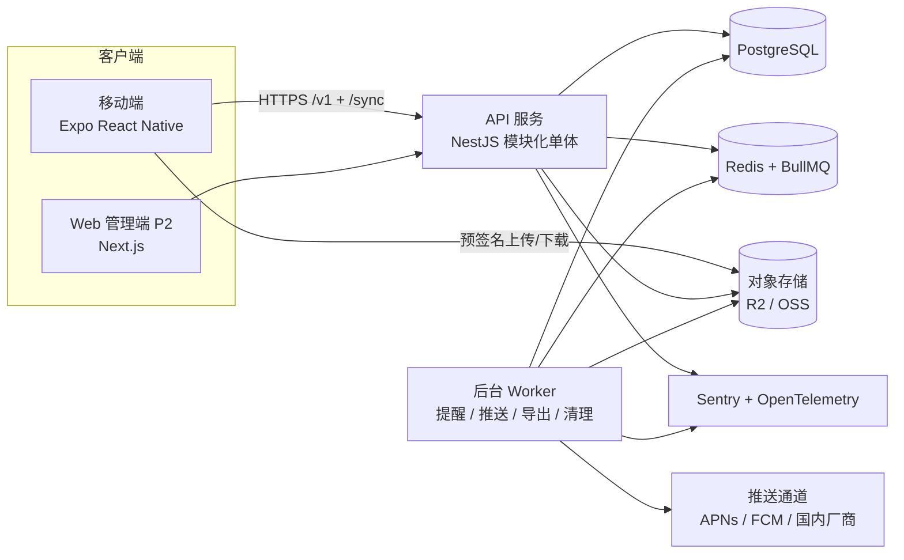
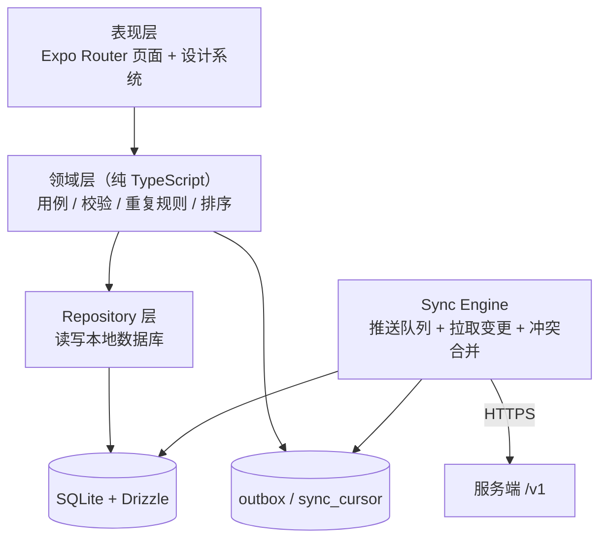
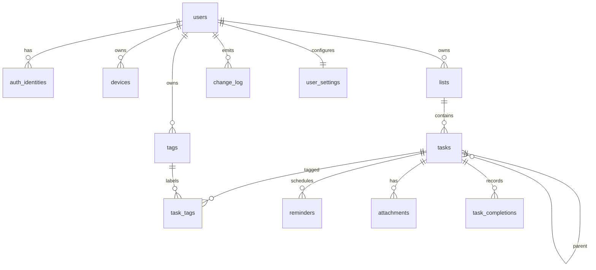

# 待办事项管理 APP 系统设计方案

| 项目 | 内容 |
| --- | --- |
| 文档版本 | v1.0（草案） |
| 日期 | 2026-11-01 |
| 状态 | 待产品与研发评审 |
| 需求来源 | Issue #1 评论：设计待办事项管理 APP 的系统架构、业务功能需求与技术栈 |
| 适用范围 | MVP（iOS / Android）→ V1 |
| 主要读者 | 产品、设计、客户端、服务端、测试 |

> 本文档由自动化代理起草，作为评审与开发的基线。技术版本以落地时的稳定版为准；文中的假设条件见 §1.5，需要业务方确认的问题见 §7.2。

## 0. 方案摘要

- **产品**：面向个人的跨端待办应用，离线优先。MVP 聚焦“快速记录、今日安排、提醒、重复任务、多端同步”五个核心闭环。
- **架构**：模块化单体 API + 独立后台 Worker + PostgreSQL + Redis；客户端以 SQLite 为本地事实源，通过自研增量同步协议与服务端最终一致。
- **技术栈**：Expo（React Native）+ TypeScript 客户端；NestJS + PostgreSQL + Drizzle 服务端；BullMQ 任务队列；Expo Push / 国内厂商推送；海外部署 Fly.io + Neon + Cloudflare R2，国内部署阿里云或腾讯云。
- **同步**：每用户单调递增 `seq` + 客户端 Outbox；服务端按用户串行写入，字段级合并 + 服务端优先冲突裁决，墓碑删除，30 天变更日志，游标过期时全量重建。
- **规模**：首版按 10 万注册用户、1000 万任务设计；单用户 5 万任务以内。
- **周期与成本**：1 人约 15–16 周、2 名全职开发约 8–9 周完成 MVP；基础设施约 50–350 美元/月（典型 100–200，估算见 §5.3）。
- **主要风险**：同步正确性、国内 Android 推送到达率、范围蔓延。
- **待确认**：首发市场（影响推送、合规与云服务）、平台优先级、是否要多人协作、团队技术背景。

## 1. 概述

### 1.1 背景

待办事项管理是高频、低门槛的个人效率工具。用户的核心诉求不是“功能多”，而是：

1. **记录快**：3 秒内记下一件事，不打断当前工作；
2. **找得到**：今天做什么、这件事属于哪个清单、什么时候提醒；
3. **不丢数据**：地铁、飞机、弱网下都能改，联网后自动同步；
4. **跨设备**：手机、平板、网页看到同一份数据；
5. **可掌控**：能导出、能删除、没有广告和强制订阅。

本方案据此定义一个可落地的 MVP，并为后续多人协作、Web 端和平台集成预留扩展点。

### 1.2 产品定位

一句话定位：**一个快、稳、离线可用的个人待办应用。**

- 面向个人用户，不做 Jira 式的复杂项目管理；
- 以“今天”和“收件箱”为默认入口，降低组织成本；
- 数据本地优先，同步无感；
- 不做社交、不做内容社区、不做广告。

### 1.3 目标用户与核心场景

| 用户群 | 典型场景 | 当前痛点 | 本产品价值 |
| --- | --- | --- | --- |
| 学生 | 课程作业、考试复习、社团事务 | 记事分散在聊天记录和便签里 | 统一清单 + 截止提醒 + 重复任务 |
| 职场个人 | 会议待办、日报事项、临时想法 | 工作系统太重，私人事项不想混进去 | 3 秒记录、今日视图、跨端同步 |
| 自由职业者 | 多客户交付、发票、跟进 | 项目多，容易漏事 | 清单分组 + 标签 + 搜索 |
| 轻度用户 | 购物清单、家务、旅行准备 | 不想学习复杂工具 | 收件箱 + 清单 + 简单提醒 |

### 1.4 设计原则

1. **离线优先**：本地写入成功即视为成功，网络只影响同步时机，不影响操作。
2. **快于全**：MVP 不追求功能覆盖，核心路径不超过 3 步。
3. **数据属于用户**：支持导出、账户注销和彻底删除，不锁定数据。
4. **渐进式架构**：MVP 用模块化单体，验证后再拆分服务；不提前引入微服务、Kubernetes、Kafka。
5. **可测试性**：同步、时区、重复规则是最容易出错的领域逻辑，必须能在纯函数层测试。

### 1.5 假设与约束

| 编号 | 假设 | 对方案的影响 |
| --- | --- | --- |
| A1 | 以个人用户为主，多人协作放到 V2 | 权限模型、实时推送可延后，MVP 不做共享清单 |
| A2 | 首发 iOS + Android，Web 后续 | 客户端优先用跨端方案，Web 只做官网/管理后台 |
| A3 | 中文用户为主，可能面向中国大陆 | 推送、短信、云服务、合规需支持国内方案，见 §3.8、§3.10 |
| A4 | 团队 1–3 人，全栈开发 | 技术栈尽量统一语言，优先托管服务，减少运维 |
| A5 | MVP 目标 15–16 周上线（单人） | 范围严格按 §2.5 的 P0 执行，P1/P2 不插队 |
| A6 | 基础设施预算每月 50–350 美元（典型 100–200） | 使用按量付费的托管 Postgres/Redis/对象存储 |

若 A1–A6 与实际不符，需要调整的章节已在 §7.2 标出。

### 1.6 范围与非目标

**MVP 范围（P0）**：账号与设备、任务/清单 CRUD、优先级、到期日/时间、提醒、重复任务、本地搜索、离线与多端同步、设置、数据导出与账户注销、深浅色主题。

**明确不做（本期）**：

- 多人共享清单、评论、@提醒；
- 甘特图、看板、时间块、番茄钟；
- 日历双向同步、邮件转发创建任务；
- 微信小程序、桌面原生客户端、Apple Watch；
- 开放 API、插件系统、自动化规则；
- 广告、社交关系链、内容推荐。

这些能力可在 V1/V2 通过既定扩展点加入，不需要推翻当前架构。

## 2. 业务功能需求

### 2.1 功能地图

| 模块 | 功能 | 优先级 |
| --- | --- | --- |
| 账户与设备 | 邮箱验证码、Apple/Google 登录、会话与设备管理、注销、导出 | P0（国内手机号/微信 P1） |
| 任务 | 创建、编辑、完成、删除/恢复、子任务、备注、优先级、排序 | P0 |
| 清单与视图 | 收件箱、自定义清单、今天、即将到来、全部、已完成、回收站 | P0 |
| 组织与检索 | 标签、筛选、排序、本地搜索 | 标签/筛选 P1，搜索 P0 |
| 时间与提醒 | 到期日/时间、提醒、稍后提醒、时区与跨日 | P0（稍后提醒 P1） |
| 重复任务 | 每天/每周/每月/每年、间隔、结束条件 | P0 |
| 附件 | 图片/文件、缩略图、配额 | P1 |
| 离线与同步 | 本地读写、自动同步、冲突处理、状态提示 | P0 |
| 通知 | 提醒推送、权限引导、免打扰、深链 | P0 |
| 统计 | 完成数、连续完成、趋势 | P1 |
| 设置与数据 | 主题、周起始、默认清单、导出、清除数据 | P0（导入 P1） |
| 协作 | 共享清单、成员角色、实时更新 | V2 |
| 平台集成 | 桌面小组件、快捷指令、日历导出 | P2 |

优先级定义：**P0** = MVP 必须；**P1** = V1 内补齐；**P2** = V2 或验证后再做。

### 2.2 信息架构

底部导航采用 4 个一级入口：

1. **今天**：今天到期 + 已逾期未完成 + 今天完成的折叠区；
2. **清单**：收件箱、自定义清单、智能视图（即将到来、全部、已完成）；
3. **搜索**：本地即时搜索，支持按清单/标签/状态过滤（过滤能力 P1）；
4. **设置**：账户、外观、通知、数据与关于。

任务详情为全屏页面；清单详情内可直接新增任务。第一版不引入多级导航抽屉，避免“功能藏得深”。

### 2.3 核心功能需求

#### FR-1 账户与设备（P0）

- 登录方式：
  - 邮箱验证码（默认，无密码），验证码 6 位、5 分钟有效、最多尝试 5 次；
  - Sign in with Apple（iOS 必须提供，满足 App Store 审核要求）；
  - Google 登录（海外）；
  - 手机号验证码 + 微信登录（中国大陆，P1）。
- 首次登录自动创建默认“收件箱”，并写入用户时区与语言。
- 会话：访问令牌 15 分钟，刷新令牌 30 天且每次刷新轮换；刷新令牌带 `family_id` 与 `replaced_by_id`，检测到旧令牌重放时撤销整条会话链；支持“退出所有设备”。
- 令牌撤销：JWT 包含用户与设备版本号；API 每次请求用 Redis 缓存校验 `authVersion`/设备撤销状态，移除设备或注销账号后旧访问令牌在下一次请求即被拒绝，不等待 15 分钟过期。
- 设备管理：展示设备名、平台、最近活跃时间，可远程移除；被移除设备立即失效，并注销其推送 token。
- 资料：昵称、头像（预置头像，P1 支持上传）、时区（自动识别，可手动修改）、语言。
- 账户注销：应用内可发起；立即停用并撤销所有令牌，30 天内硬删除数据；注销前提示导出。
- 数据导出：导出 JSON（全量）与 CSV（任务表格），异步生成，下载链接 24 小时有效。
- 不提供“游客模式”进入 MVP，避免本地数据与账号合并的额外同步复杂度（P1 再评估）。

**验收要点**

- 无网络时已登录用户可正常使用全部 P0 功能；
- 刷新令牌重放会被识别并撤销整条会话链；
- 移除设备或注销账号后，旧访问令牌在下一次请求即被拒绝，注销后无法访问任何数据。

#### FR-2 任务管理（P0）

- 快速创建：只填标题即可保存；标题 1–500 字符；默认放入当前清单。
- 任务字段：
  - 标题、备注（Markdown，≤10,000 字符）；
  - 所属清单；
  - 优先级：无 / 低 / 中 / 高（0–3）；
  - 到期：全天日期（`due_date`）或具体时间（`due_at`），二选一；
  - 提醒：最多 5 个，相对到期时间的偏移（含自定义偏移）；
  - 重复规则：见 FR-6；
  - 标签：P1；
  - 子任务：1 层，父任务展示 `已完成/总数`；
  - 附件：P1。
- 操作：完成/取消完成、编辑、删除、恢复、复制、移动到其他清单、批量完成/删除、手动拖拽排序。
- 删除进入回收站，保留 30 天；期间可恢复，30 天后自动清理。删除与恢复都要同步到其他设备。
- 一次性任务完成后写入 `completed_at`，取消完成会清空该时间并回到原清单/视图；重复任务完成**当前实例**后推进到下一次实例并写入 `last_completed_at`，任务保持未完成状态（见 FR-6）。每次完成生成 `completionId`；5 秒内撤销携带该 ID 恢复旧值，超时或已被后续完成覆盖则不可撤销。
- 列表默认只显示未完成任务；可在清单内切换“显示已完成”。
- 排序：手动（默认，按 `sort_rank`）、按到期时间、按优先级、按创建时间；排序偏好按清单记忆（P1）。
- 操作反馈：删除与完成后提供 5 秒撤销（Snackbar），撤销本身也走同步。

**验收要点**

- 飞行模式下创建、编辑、完成、删除均立即生效，重启 App 后数据仍在；
- 同一秒内连续点击“完成”不会产生重复的完成记录或重复同步；
- 恢复已删除任务后，其他在线设备在下一轮同步（≤60 秒）内可见。

#### FR-3 清单与视图（P0）

- 系统清单：收件箱（每个用户唯一，不可删除）、回收站。
- 自定义清单：名称（1–50 字符）、颜色、图标、排序、归档；清单数量上限 500。
- 删除清单：默认把未完成任务移动到收件箱；二次确认后可选择“连同任务一起删除”。
- 智能视图：
  - **今天**：`due_date = 今天` 或 `due_at` 落在今天，或已逾期且未完成；
  - **即将到来**：未来 7 天内到期；
  - **全部**：所有未完成任务（可按清单过滤）；
  - **已完成**：最近 90 天完成的任务；
  - **回收站**：最近 30 天删除的任务。
- 视图按用户时区计算“今天”的边界；应用在前台跨过午夜时自动刷新。
- 每个清单展示未完成数量徽标；清单详情支持按“逾期 / 今天 / 之后 / 无日期”分组（P1）。

**验收要点**

- 把任务移到另一个清单后，原清单计数减一、目标清单加一，且其他设备一致；
- 跨时区后“今天”视图按新时区重新计算；
- 删除清单时用户明确选择任务去向，不出现静默丢任务。

#### FR-4 组织、筛选与搜索（搜索 P0，标签/筛选 P1）

- 搜索：标题与备注的子串匹配，中文 2 字即可触发；本地即时（200ms 防抖），无网可用；结果按更新时间倒序，高亮关键词。
- 标签：每个用户可创建标签（名称、颜色），一个任务最多 10 个标签；标签名在用户内唯一。
- 筛选：按清单、状态、标签、优先级、到期范围组合过滤；筛选条件可保存为自定义筛选（P2）。
- 排序：到期时间、优先级、创建时间、标题；升/降序。
- 服务端搜索（Web/跨端兜底）使用 PostgreSQL `pg_trgm` + `ILIKE`，中文分词能力有限，作为兜底而非主路径。

**验收要点**

- 搜索中文短词能命中标题与备注；
- 50,000 条任务下本地搜索 P95 < 200ms（2 字查询走回退路径）；
- 标签删除后任务保留，关联自动解除。

#### FR-5 时间与提醒（P0）

- 日期语义：
  - **全天任务**用 `due_date`（用户本地日历日期），无具体时刻；
  - **定时任务**用 `due_at`（UTC 时间戳），显示时转换为用户时区；
  - 二者互斥，可都不填。
- 提醒：
  - 任务有到期时间时可添加提醒；偏移选项：准时、提前 5/10/30 分钟、提前 1 小时、提前 1 天、自定义；
  - 全天任务默认在当天 09:00（用户可改默认时间）提醒；
  - 最多 5 个提醒；任务完成、删除或改期后，旧提醒必须失效。
- 通知到达后点击直接打开任务详情；通知权限被拒绝时，在任务创建/编辑页给出一次非阻塞提示。
- 稍后提醒（P1）：通知操作支持“10 分钟后 / 1 小时后 / 明天早上”。
- 时区与夏令时：重复规则按任务 `recurrence_timezone` 的本地墙钟展开；全天任务与“今天”视图使用用户当前时区；提醒在实例生成时按本地墙钟重算为 UTC，用户修改时区或默认提醒时间后重算全部未发送提醒。夏令时的不存在/重复本地时间按 §3.8 处理。
- 逾期任务保留在原处并标记“已逾期”，不会每天重复推送；仅在到期时提醒一次。

**验收要点**

- 修改提醒时间后，旧时间点不再收到通知；
- 用户跨时区后，全天任务的日期不漂移，定时任务的本地显示时间正确；
- 夏令时切换日的提醒时间符合用户预期（专项测试集覆盖）。

#### FR-6 重复任务（P0）

- 支持频率：每天、每周（可指定星期几）、每月（按日期）、每年；支持间隔（如每 2 周）。
- 结束条件：永不 / 到指定日期 / 执行 N 次；分别存 `recurrence_until`（任务时区的最后允许日期，含当天）与 `recurrence_count_remaining`（含当前实例），RRULE 只存频率部分。
- 存储：任务保存 RRULE 子集字符串（RFC 5545）、`recurrence_dtstart`（系列锚点）、`recurrence_seq`（当前实例序号）、`recurrence_timezone`；服务端与客户端共用同一套校验。
- 完成语义（“完成”指**完成当前实例**，不是结束整个系列）：
  - 完成当前实例时，写 `last_completed_at` 并推进到下一次发生时间，`recurrence_seq + 1`，`completed_at` 保持空；
  - 若用户补完成一个较早实例，直接推进到“下一次不早于当前时间”的实例，跳过中间过期实例；
  - 未完成且已过期时保留为逾期任务，不重复生成新实例；
  - 次数用尽或超过截止日期时，写 `completed_at` 结束系列，任务进入已完成。
- 完成幂等：完成请求携带当前实例的 `occurrenceKey` 与 `completionId`；服务端在 `todo.task_completions` 中以 `(task_id, occurrence_key)` 唯一约束防止同一实例被两台设备完成两次。撤销最近一次完成时按 `completionId` 恢复台账记录的旧到期时间、计数、序号与上次完成时间。
- 编辑/删除范围：MVP 仅支持“整个系列”；编辑规则以当前实例日期为基准重算后续，UI 必须明确提示影响范围。单次实例的例外编辑放到 P1。
- 所有提醒随实例推进自动重算；旧实例提醒取消。
- 边界规则：每月/每年按日期重复而目标日期不存在时，取该月最后一天（例如每月 31 日在 2 月取 28/29 日）；夏令时期间的不存在/重复本地时间按 §3.8 的规则处理。
- 完成历史：完成台账由服务端保存，P2 用于统计与回顾；MVP/P1 的已完成视图展示 `completed_at` 非空的任务（包括已结束的重复系列），但不展示重复任务的历史实例明细。

**验收要点**

- 每周一 09:00 的重复任务，完成后下一次为下周一 09:00；
- 连续三周未完成，列表只出现一条逾期任务，提醒不重复轰炸；
- 修改重复规则后，未来的到期时间按新规则生成，不产生重复实例；
- 两台设备离线完成同一实例，服务端只记录一次，下一实例不被重复推进。

#### FR-7 备注与附件（备注 P0，附件 P1）

- 备注支持 Markdown 子集：加粗、斜体、标题、列表、引用、链接、行内代码；输入框提供基础工具栏。
- 链接用内置浏览器打开；Markdown 渲染需做 XSS 过滤（即使内容来自本人）。
- 附件（P1）：图片（JPEG/PNG/WebP）与 PDF，单文件 ≤20MB，单任务 ≤5 个，免费配额 500MB；上传使用预签名 URL 直传对象存储。
- 附件元数据随任务同步，二进制不走同步日志；离线时显示占位与缓存状态。
- 删除附件先软删除，7 天后由清理任务物理删除。

#### FR-8 离线与同步（P0）

- 所有 P0 读写默认走本地数据库，网络只用于同步。
- 同步状态对用户可见：`已同步` / `同步中` / `离线` / `N 项待同步` / `有冲突`。
- 触发时机：应用启动、回到前台、本地写入后 500ms 防抖、网络恢复、前台每 60 秒；不做常驻后台同步。
- 多设备：任一设备修改后，其他在线设备在前台时，在下一轮同步（≤60 秒）内看到；回到前台或网络恢复会立即触发同步。MVP 不承诺 5 秒级实时性，V1 可加 SSE/长轮询。
- 冲突：不同字段的并发修改自动合并；同一字段冲突保留服务端版本，并在任务上标记“已合并冲突”（P1 提供冲突详情页），不静默覆盖用户输入。
- 可靠性：服务端确认（ack）前，客户端不得丢弃本地操作；ack 后断电重启，数据仍可从服务端恢复。
- 游标过期：超过 30 天未同步的设备，提示“需要重新同步”，在本地待同步操作上传后做全量重建；重建期间不清空用户可见数据，采用影子表切换。
- 同步失败：指数退避 + 抖动，最多 5 次后进入“稍后重试”，用户可手动触发。

**验收要点**

- 在 30% 丢包、随机断网的模拟下，已 ack 的操作不丢、不重复；
- 两台设备并发编辑不同字段，最终双方状态一致；
- 删除在弱网延迟下不会“复活”。

#### FR-9 通知（P0）

- 类型：任务提醒（P0）、每日摘要（P1）、协作动态（V2）。
- 设备注册：登录后请求通知权限，拿到 APNs/FCM/厂商 token 后注册到服务端；token 变化时更新，退出登录或移除设备时注销。
- 免打扰：用户可设置时段；免打扰只影响摘要、协作等非关键通知，**用户显式设置的提醒照常发送**（若用户希望提醒也静默，需在通知设置中单独开启）。
- 应用内通知中心（P1）：记录最近提醒，便于找回。
- 提醒身份：每条提醒使用稳定的 `reminderId` 与 `occurrenceKey`，用于服务端幂等、客户端去重和通知折叠。
- 迟到策略：服务端对迟到提醒在 24 小时内补发一次；超过 24 小时标记过期，不补发。不因迟到几分钟丢弃，避免服务端故障或设备短暂离线导致漏提醒。
- 推送失败：记录尝试次数与错误码；MVP 清理推送接口返回的明确失效 token，完整 receipt 查询与重试回执放 P1；推送到达率纳入监控。

**验收要点**

- 正常路径同一提醒只收到一次；重试与本地补发造成的极端重复由客户端按 `reminderId` 去重展示；
- 通知点击能深链到对应任务，任务不存在时进入今天视图；
- 更换/移除设备后旧 token 不再收到通知。

#### FR-10 统计与回顾（P1）

- 今日/本周完成数、连续完成天数、最近 30 天完成趋势。
- P1 只做**本机统计**：基于本地 `completed_at` / `last_completed_at` 计算一次性任务完成数与最近趋势，不上传行为明细；重复任务只统计最近一次完成时间，不提供历史明细。
- 跨端一致的完整完成历史放 P2：服务端基于 `todo.task_completions` 聚合，上线前单独评估隐私与授权；P1 不承诺多端统计一致。
- 不做排行榜、不做社交分享（避免隐私与合规成本）。

#### FR-11 设置与数据（P0）

- 外观：跟随系统 / 浅色 / 深色，强调色（4 种），触感反馈开关。
- 行为：周起始日（周一/周日）、默认清单、默认提醒时间、24 小时制、默认优先级。默认提醒时间、默认清单、免打扰与通知偏好写入 `identity.user_settings`，供服务端物化提醒；纯展示偏好可仅本地保存。
- 语言：简体中文 / English（P1 完善翻译）。
- 通知：权限状态、提醒开关、免打扰时段、每日摘要（P1）。
- 数据：导出 JSON/CSV、导入 JSON（P1）、清除已完成任务、清空回收站、注销账号。
- 关于：版本、隐私政策、用户协议、开源许可、同步诊断信息（P1，便于支持排障）。
- 清除类操作必须二次确认；危险操作按钮与普通按钮有明显视觉区分。

#### FR-12 协作（V2，本期不做）

提前预留以下扩展点，避免后续重构：

- `list_members` 表与角色（owner/editor/viewer）；
- 所有列表/任务查询增加 ACL 过滤；
- 变更日志按“用户 + 共享清单”扩展，实时更新通过 SSE 通知“有新版本”后走同一拉取接口；
- 冲突策略沿用服务端优先的字段级合并，并在协作场景提供冲突提示；实时协作若需要更细粒度合并，再评估 CRDT；
- 应用商店合规：共享清单属于用户生成内容，需要举报/屏蔽入口与审核流程。

#### FR-13 平台集成（P2）

- 桌面小组件：iOS WidgetKit / Android Glance，展示今天与计数；
- 快捷指令 / 分享扩展：把文本快速存为任务；
- 日历导出：生成 ICS 订阅链接，只读单向；
- Apple Watch：仅查看今天与勾选完成。

### 2.4 用户故事与验收标准

| 编号 | 用户故事 | 验收标准（摘要） |
| --- | --- | --- |
| US-01 | 作为用户，我希望在地铁里也能 3 秒记下一件事 | 离线创建成功；重启后仍在；恢复网络后立即触发同步（通常 ≤10 秒）；重复提交不产生重复任务 |
| US-02 | 作为用户，我希望打开“今天”就知道要做什么 | 今天到期 + 逾期 + 今天完成折叠区正确；时区变化后重算；跨午夜自动刷新 |
| US-03 | 作为用户，我希望到点收到提醒 | 到点推送一次；改期后旧提醒不触发；点击打开详情；无权限时有提示 |
| US-04 | 作为用户，我希望每周重复的家务自动出现 | 完成后推进到下周；跳过过期实例；修改规则影响未来；提醒重算 |
| US-05 | 作为用户，我希望手机和平板看到同一份数据 | 在线设备在前台同步周期（≤60 秒）内可见；不同字段并发修改自动合并；同字段冲突保留服务端版本并提示；删除不复活；已确认操作不丢 |
| US-06 | 作为用户，我希望搜索两三个字就能找到任务 | 200ms 内返回；标题/备注命中；无网可用；结果高亮 |
| US-07 | 作为用户，我希望随时导出或彻底删除我的数据 | 导出 JSON/CSV；注销后 30 天内删除；旧令牌立即失效 |
| US-08 | 作为用户，我误删任务后希望恢复 | 5 秒撤销；回收站 30 天可恢复；恢复同步到其他设备 |

### 2.5 MVP 范围与工作量估算

| 模块 | MVP 包含 | 估算（人日） |
| --- | --- | --- |
| 工程基座 | Monorepo、CI、环境、设计系统基础、代码规范 | 4 |
| 账户与设备 | 邮箱验证码、Apple/Google 登录、会话、设备管理、注销 | 6 |
| 清单与任务 | 清单/任务 CRUD、子任务、备注、优先级、排序、回收站、撤销 | 10 |
| 同步 | Outbox、push/pull、冲突处理、全量重建、同步状态 UI | 16 |
| 提醒与通知 | 提醒物化、调度器、推送、离线补发、权限引导、时区处理 | 8 |
| 重复任务 | RRULE 子集、完成推进、系列编辑、提醒重算 | 5 |
| 搜索与筛选 | 本地搜索、排序、视图过滤 | 4 |
| 设置与数据 | 主题、偏好、导出、清除数据 | 3 |
| 质量与上架 | 测试、性能、无障碍、隐私合规、商店素材与审核 | 12 |
| **合计** | | **约 68 人日（±25%）** |

结论：单人约 15–16 周（含缓冲）；两名全职开发并行约 8–9 周。同步与提醒是关键路径，建议最先做技术验证。

P1 候选：标签、附件、统计、稍后提醒、导入、每日摘要、国内登录方式、桌面小组件。

P2 候选：多人协作、Web（只读/完整应用/管理后台）、日历双向同步、开放 API、订阅与付费。

### 2.6 非功能需求

| 编号 | 类别 | 指标 |
| --- | --- | --- |
| NFR-1 | 性能 | 冷启动 P95 ≤ 1.5s（中端机）；本地任务操作 P95 ≤ 50ms；页面切换 ≤ 100ms |
| NFR-2 | 同步性能 | 500 条变更在 4G 下 P95 ≤ 2s；单次 push 批量 ≤ 100 条 |
| NFR-3 | 可用性 | API 月度可用性 ≥ 99.9%；离线状态核心功能可用率 100% |
| NFR-4 | 数据可靠性 | 已 ack 写入不丢失；RPO ≤ 5 分钟（PITR）；RTO ≤ 1 小时 |
| NFR-5 | 容量 | 单用户 5 万任务、500 清单；系统 10 万注册用户、1000 万任务 |
| NFR-6 | 安全 | TLS 1.2+；令牌安全存储；OWASP MASVS L1；最小权限 |
| NFR-7 | 隐私 | 支持导出与删除；日志脱敏；符合《个人信息保护法》与 GDPR 基本要求 |
| NFR-8 | 兼容性 | iOS 16+、Android 9+；深色模式；大字号；VoiceOver/TalkBack 可用 |
| NFR-9 | 国际化 | 简体中文/英文；时区、周起始日、12/24 小时制可配置 |
| NFR-10 | 可观测性 | 关键链路可追踪；错误与延迟告警 5 分钟内触达 |
| NFR-11 | 能耗与网络 | 同步批量 + 退避；前台不轮询超过 1 次/分钟；后台无常驻任务 |

### 2.7 数据指标

只采集与产品改进直接相关、且用户可关闭的匿名事件：

- 激活：首次启动 → 创建第一个任务 → 7 日内再次打开；
- 留存：次日/7 日/30 日留存；
- 使用：每周创建任务数、完成率、今天视图使用率、提醒点击率；
- 质量：同步失败率、冲突率、提醒延迟 P95、崩溃率（目标 < 0.5%）。

不采集任务内容、备注文本。分析工具优先选用可自托管或隐私友好的方案（如 PostHog），并在隐私政策中说明。

## 3. 系统架构

### 3.1 总体架构



**核心数据流**

1. 客户端所有读写落在本地 SQLite；写操作在同一事务中写业务表与 `outbox`。
2. 同步引擎把 `outbox` 批量推送到服务端；服务端按用户串行应用、递增 `seq`、写变更日志。
3. 客户端按 `seq` 拉取增量变更并在事务中应用；本地是读模型，服务端是最终仲裁者。
4. 提醒由服务端调度并通过推送送达；附件用预签名 URL 直传对象存储。

### 3.2 架构风格与取舍

- **模块化单体优先**：一个 API 进程内按领域分模块（identity、todo、sync、notify、files），模块间通过显式接口调用，不共享表访问路径。初期不拆微服务，避免分布式事务、服务发现、链路追踪复杂度。
- **API + Worker 同代码库、分开部署**：同步请求走 API；提醒轮询、推送、导出、清理等异步任务走 Worker，互不阻塞。
- **PostgreSQL 单库多 schema**：`identity`、`todo`、`sync`、`notify`、`ops` 分 schema，保留未来按模块拆库的可能；一个事务内可跨 schema 保证一致性。
- **不用 GraphQL**：客户端以本地数据库为读模型，只需要少量批处理接口和同步接口；REST + OpenAPI 更简单，移动端网络成本更低。
- **不用消息中间件（Kafka 等）**：MVP 量级下 BullMQ + Postgres 足够；真正的跨服务事件流等到拆服务时再引入。
- **不做 BFF**：移动端与 Web 差异不大，API 直接服务两端；Web 的聚合逻辑放在 Next.js 服务端即可。

### 3.3 客户端架构



职责划分：

- **表现层**：页面与组件，只调用用例；不做数据合并，不直接发网络请求。
- **领域层**：纯函数与用例，负责标题校验、日期语义、重复规则推进、排序、权限（未来）等，可在 Node 环境单测。
- **Repository**：把领域对象映射到 SQLite；所有写操作通过事务包裹“业务表 + outbox”。
- **Sync Engine**：独立模块，负责批量上传、拉取、游标、退避、冲突应用；不直接操作 UI。
- **状态管理**：Zustand 管理 UI 状态与会话；TanStack Query 仅用于非本地同步的数据（如导出任务、统计聚合），不用于任务列表，避免双份缓存。

**客户端关键约束**

- 本地数据库是唯一事实源；网络失败不阻塞 UI。
- 每次写入生成客户端 UUIDv7 与 `opId`；`opId` 用于服务端幂等。
- 列表使用 `FlashList` 虚拟化；任务行按 `updated_at` 订阅刷新。
- 令牌存 Keychain/Keystore（`expo-secure-store`）；不写日志。
- 深色模式、动态字体、无障碍标签从第一版就纳入组件规范。
- 使用 Expo Development Build（含推送等原生模块），不依赖 Expo Go。

### 3.4 服务端模块

| 模块 | 职责 | 关键接口/任务 |
| --- | --- | --- |
| Identity | 验证码、Apple/Google 校验、令牌签发与轮换、设备管理、注销 | `/v1/auth/*`、`/v1/devices` |
| Todo | 清单、任务、标签、提醒规格、排序、回收站 | `/v1/lists`、`/v1/tasks` |
| Sync | 变更日志、幂等处理、冲突合并、快照游标 | `/v1/sync/*` |
| Notify | 提醒物化、调度、推送、token 管理 | 定时轮询 + 推送通道 |
| Files | 预签名上传、附件元数据、配额、清理 | `/v1/attachments/*` |
| Export | 异步导出 JSON/CSV、下载签名 | `/v1/export/*` |
| Ops | 清理任务、审计、特性开关、健康检查 | 内部接口 |

模块规则：

- 每个模块拥有自己的 schema 与仓储接口，跨模块只调用公开服务；
- 身份与权限在网关层（Guard）统一处理，领域层只接收 `userId`；
- 所有写接口必须携带幂等键或 `opId`（同步接口）；
- 审计事件（登录、设备移除、注销、导出）写 `ops.audit_log`，不记录任务内容。

### 3.5 数据模型



主要表：

| Schema.表 | 关键字段 | 约束与索引 | 说明 |
| --- | --- | --- | --- |
| identity.users | id, email, display_name, timezone, locale, auth_version, created_at, deleted_at | email 部分唯一（不区分大小写，WHERE deleted_at IS NULL） | 用户主表；注销后软删 30 天；auth_version 用于立即撤销令牌 |
| identity.auth_identities | id, user_id, provider, provider_user_id | (provider, provider_user_id) 唯一 | Apple/Google/邮箱等身份 |
| identity.devices | id, user_id, name, platform, push_token, push_provider, auth_version, last_seen_at, revoked_at | (user_id) 索引 | 设备与会话管理 |
| identity.refresh_tokens | id, user_id, device_id, family_id, replaced_by_id, token_hash, expires_at, rotated_at, revoked_at | token_hash 唯一；(family_id) 索引 | 只存哈希，轮换与重放检测 |
| identity.user_settings | user_id, theme, accent, week_start, default_list_id, default_reminder_time, time_format, quiet_hours, notification_prefs, updated_at | 主键 user_id | 服务端与客户端共享的偏好，PATCH /me 写入 |
| todo.lists | id, user_id, name, color, icon, sort_rank, is_archived, is_default, version, deleted_at | (user_id, sort_rank)；UNIQUE(user_id, id)；默认收件箱部分唯一 | 收件箱 `is_default` |
| todo.tasks | 见下方 DDL | 见下方索引 | 任务主表 |
| todo.tags | id, user_id, name, color, version, deleted_at | UNIQUE(user_id, id)；名称部分唯一 | 标签 |
| todo.task_tags | user_id, task_id, tag_id | 复合外键校验同租户；联合主键 (task_id, tag_id) | 多对多 |
| todo.task_completions | id, user_id, task_id, occurrence_key, completed_at, device_id, previous_due_at, previous_due_date, previous_count_remaining, previous_seq, previous_last_completed_at | UNIQUE(task_id, occurrence_key) | 重复任务完成台账；服务端幂等/撤销，P2 统计；不参与客户端同步 |
| notify.reminders | id, user_id, task_id, reminder_key, occurrence_key, remind_at, status, claimed_at, sent_at, attempt_count, created_at | 部分索引 (remind_at) WHERE status='pending'；UNIQUE(task_id, occurrence_key, reminder_key, remind_at) | 服务端物化的提醒，不参与客户端同步；reminder_key 对应 reminder_spec.id；改期时旧行取消、新行插入 |
| todo.attachments | id, user_id, task_id, storage_key, filename, mime, size, checksum, deleted_at | (task_id) | 文件元数据 |
| sync.change_log | user_id, seq, entity_type, entity_id, entity_version, op, changed_fields, device_id, created_at | 主键 (user_id, seq)；索引 (user_id, entity_type, entity_id, entity_version) | 增量同步日志，保留 30 天 |
| sync.user_sync_state | user_id, current_seq | 主键 user_id | 每用户序号 |
| sync.processed_ops | user_id, op_id, result, created_at | 主键 (user_id, op_id) | 幂等去重，保留 30 天 |
| ops.export_jobs | id, user_id, status, format, storage_key, expires_at | (user_id, created_at) | 异步导出 |
| ops.audit_log | id, user_id, event, ip_hash, metadata, created_at | (user_id, created_at) | 安全审计，不含任务内容 |

任务主表、完成台账与变更日志的简化 DDL：

```sql
-- todo.tasks
CREATE TABLE todo.tasks (
  id              uuid PRIMARY KEY,
  user_id         uuid NOT NULL REFERENCES identity.users(id),
  list_id         uuid NOT NULL,
  parent_id       uuid,
  title           text NOT NULL CHECK (char_length(title) BETWEEN 1 AND 500),
  notes           text NOT NULL DEFAULT '',
  priority        smallint NOT NULL DEFAULT 0 CHECK (priority BETWEEN 0 AND 3),
  due_date        date,
  due_at          timestamptz,
  completed_at    timestamptz,
  last_completed_at timestamptz,
  recurrence_rule text,
  recurrence_dtstart timestamptz,
  recurrence_until date,
  recurrence_count_remaining smallint CHECK (recurrence_count_remaining >= 0),
  recurrence_seq  integer NOT NULL DEFAULT 0 CHECK (recurrence_seq >= 0),
  recurrence_timezone text,
  reminder_spec   jsonb NOT NULL DEFAULT '[]'::jsonb,
  sort_rank       text NOT NULL,
  version         bigint NOT NULL DEFAULT 1,
  created_at      timestamptz NOT NULL DEFAULT now(),
  updated_at      timestamptz NOT NULL DEFAULT now(),
  deleted_at      timestamptz,
  CONSTRAINT due_at_most_one CHECK (num_nonnulls(due_date, due_at) <= 1),
  CONSTRAINT parent_not_self CHECK (parent_id IS NULL OR parent_id <> id),
  CONSTRAINT tasks_user_id_id_key UNIQUE (user_id, id)
);

ALTER TABLE todo.lists ADD CONSTRAINT lists_user_id_id_key UNIQUE (user_id, id);
ALTER TABLE todo.tags ADD CONSTRAINT tags_user_id_id_key UNIQUE (user_id, id);
ALTER TABLE todo.tasks
  ADD CONSTRAINT tasks_list_fk FOREIGN KEY (user_id, list_id)
  REFERENCES todo.lists (user_id, id);
ALTER TABLE todo.tasks
  ADD CONSTRAINT tasks_parent_fk FOREIGN KEY (user_id, parent_id)
  REFERENCES todo.tasks (user_id, id);

CREATE UNIQUE INDEX lists_one_default ON todo.lists (user_id)
  WHERE is_default AND deleted_at IS NULL;
CREATE UNIQUE INDEX tags_name_unique ON todo.tags (user_id, lower(name))
  WHERE deleted_at IS NULL;
CREATE INDEX tasks_open_by_list ON todo.tasks (user_id, list_id, sort_rank)
  WHERE deleted_at IS NULL AND completed_at IS NULL;
CREATE INDEX tasks_due_at ON todo.tasks (user_id, due_at)
  WHERE deleted_at IS NULL AND completed_at IS NULL;
CREATE INDEX tasks_due_date ON todo.tasks (user_id, due_date)
  WHERE deleted_at IS NULL AND completed_at IS NULL;
CREATE INDEX tasks_completed ON todo.tasks (user_id, completed_at)
  WHERE deleted_at IS NULL AND completed_at IS NOT NULL;
CREATE EXTENSION IF NOT EXISTS pg_trgm;
CREATE INDEX tasks_title_trgm ON todo.tasks USING gin (title gin_trgm_ops);

-- 重复任务完成台账（服务端）
CREATE TABLE todo.task_completions (
  id              uuid PRIMARY KEY,
  user_id         uuid NOT NULL,
  task_id         uuid NOT NULL,
  occurrence_key  text NOT NULL,
  occurrence_due_at timestamptz,
  occurrence_due_date date,
  completed_at    timestamptz NOT NULL,
  device_id       uuid,
  previous_due_at timestamptz,
  previous_due_date date,
  previous_count_remaining smallint,
  previous_seq    integer,
  previous_last_completed_at timestamptz,
  created_at      timestamptz NOT NULL DEFAULT now(),
  UNIQUE (task_id, occurrence_key),
  FOREIGN KEY (user_id, task_id) REFERENCES todo.tasks (user_id, id)
);
CREATE INDEX task_completions_stats ON todo.task_completions (user_id, completed_at);

-- 提醒调度
CREATE TABLE notify.reminders (
  id              uuid PRIMARY KEY,
  user_id         uuid NOT NULL,
  task_id         uuid NOT NULL,
  reminder_key    text NOT NULL,
  occurrence_key  text NOT NULL,
  remind_at       timestamptz NOT NULL,
  status          text NOT NULL DEFAULT 'pending'
                  CHECK (status IN ('pending', 'processing', 'sent', 'failed', 'canceled', 'expired')),
  claimed_at      timestamptz,
  sent_at         timestamptz,
  attempt_count   smallint NOT NULL DEFAULT 0,
  created_at      timestamptz NOT NULL DEFAULT now(),
  UNIQUE (task_id, occurrence_key, reminder_key, remind_at),
  FOREIGN KEY (user_id, task_id) REFERENCES todo.tasks (user_id, id)
);
CREATE INDEX reminders_pending ON notify.reminders (remind_at)
  WHERE status = 'pending';

-- sync.change_log
CREATE TABLE sync.change_log (
  user_id         uuid NOT NULL,
  seq             bigint NOT NULL,
  entity_type     text NOT NULL,
  entity_id       uuid NOT NULL,
  entity_version  bigint NOT NULL,
  op              text NOT NULL CHECK (op IN ('upsert', 'delete')),
  changed_fields  jsonb NOT NULL DEFAULT '{}'::jsonb,
  device_id       uuid,
  created_at      timestamptz NOT NULL DEFAULT now(),
  PRIMARY KEY (user_id, seq)
);
CREATE INDEX change_log_entity ON sync.change_log
  (user_id, entity_type, entity_id, entity_version);
```

数据规则：

- **ID**：客户端生成 UUIDv7，离线创建无需服务端分配；服务端补写时校验归属。
- **时间**：所有时间戳存 UTC；`due_date` 是用户本地日历日期，不做时区换算。
- **版本**：`version` 由服务端递增，客户端只能带 `baseVersion` 发起修改，不能自行指定新版本。
- **完成状态**：一次性任务用 `completed_at` 表示完成；重复任务完成当前实例后写 `last_completed_at`，`completed_at` 保持空，直到次数或截止条件耗尽才写 `completed_at` 并结束系列。
- **重复任务台账**：`recurrence_dtstart` 是系列锚点（本地墙钟 + `recurrence_timezone`），`recurrence_seq` 是当前实例序号，`recurrence_count_remaining` 是剩余可完成次数（含当前实例）。完成/撤销是专用操作，携带 `occurrenceKey`（全天 `date:YYYY-MM-DD`，定时 `at:<ISO>`）与 `completionId`；服务端写 `todo.task_completions`（唯一键 `task_id + occurrence_key`）保证同一实例最多完成一次，并记录撤销所需的旧值。台账只服务端保存，不进入同步日志；P2 统计由服务端聚合。
- **软删除**：任务/清单/标签删除写 `deleted_at` 墓碑；30 天后物理清理；同步日志中的 delete 操作保证其他设备删除。
- **排序**：使用分数索引字符串（fractional indexing），在任意两条记录之间插入无需重排全表。
- **多租户完整性**：`lists`、`tasks`、`tags` 需要 `UNIQUE(user_id, id)` 以支持 `(user_id, list_id)`、`(user_id, parent_id)` 复合外键；`task_tags` 使用复合外键校验任务与标签同属一个用户；子任务深度 1 由应用层校验并测试；标签名、默认收件箱、提醒 occurrence 使用部分唯一索引；用户邮箱在 `deleted_at IS NULL` 时唯一。
- **标签**：P1；`task_tags` 的变更随任务 `tagIds` 一起写入变更日志。
- **附件**：P1；二进制放对象存储，元数据表与任务关联，通过独立接口上传。
- **提醒**：`reminder_spec` 是数组，元素为 `{id, offsetMinutes}`，最多 5 个；MVP 不支持绝对时间或重复提醒，全天任务以本地 09:00 为基准。`reminder_spec.id` 作为 `notify.reminders.reminder_key` 与本地通知的 `reminderId`，保证跨端去重。服务端物化为绝对时间行；提醒行不进入同步日志；客户端在 push 中上报 `localDeliveries` 用于离线补发去重。
- **设置**：`identity.user_settings` 保存主题、周起始、默认清单、默认提醒时间、24 小时制、免打扰与通知偏好；PATCH /me 写入，服务端以默认提醒时间物化全天提醒。

### 3.6 API 设计

**通用约定**

- 前缀 `/v1`，JSON，字段 camelCase；时间为 ISO 8601 UTC，日期为 `YYYY-MM-DD`。
- 认证：`Authorization: Bearer <accessToken>`；访问令牌 15 分钟。
- 错误结构：

```json
{
  "error": {
    "code": "VERSION_CONFLICT",
    "message": "任务已被其他设备修改",
    "details": { "currentVersion": 7 },
    "requestId": "req_01J..."
  }
}
```

- 错误码：`VALIDATION_ERROR`、`UNAUTHENTICATED`、`FORBIDDEN`、`NOT_FOUND`、`VERSION_CONFLICT`、`DELETED`、`REBUILD_REQUIRED`、`CURSOR_EXPIRED`、`RATE_LIMITED`、`INTERNAL`。
- 分页：游标分页，不使用 offset；任务列表按 `sort_rank`，同步按 `seq`。
- 幂等：非同步写接口接受 `Idempotency-Key`；同步接口用 `opId`。
- 限流：每用户 120 请求/分钟，同步 20 次/分钟；验证码按邮箱/IP 双维度限制。
- 版本化：URL 主版本；破坏性变更至少保留 6 个月旧版本。
- 文档：NestJS 生成 OpenAPI 3（以工具链支持版本为准），CI 校验契约变更；客户端 SDK 由 OpenAPI 生成类型。

**主要接口**

| 方法 | 路径 | 说明 |
| --- | --- | --- |
| POST | `/v1/auth/otp/request` | 发送邮箱验证码 |
| POST | `/v1/auth/otp/verify` | 验证并签发令牌，注册设备 |
| POST | `/v1/auth/oauth/apple` | Apple identityToken 换取令牌 |
| POST | `/v1/auth/oauth/google` | Google idToken 换取令牌 |
| POST | `/v1/auth/refresh` | 轮换刷新令牌 |
| POST | `/v1/auth/logout` | 退出当前设备 |
| POST | `/v1/auth/logout-all` | 退出所有设备并撤销刷新令牌 |
| GET | `/v1/me` | 当前用户与偏好 |
| PATCH | `/v1/me` | 更新昵称、时区、语言、通知偏好、默认提醒时间等设置 |
| DELETE | `/v1/me` | 注销账号（异步清理） |
| GET | `/v1/devices` | 设备列表 |
| PATCH | `/v1/devices/{id}` | 更新设备名或推送 token |
| DELETE | `/v1/devices/{id}` | 移除设备，令牌失效 |
| GET | `/v1/lists` | 清单列表 |
| POST | `/v1/lists` | 新建清单 |
| PATCH | `/v1/lists/{id}` | 编辑/归档/排序 |
| DELETE | `/v1/lists/{id}` | 删除清单（指定任务去向） |
| GET | `/v1/tasks` | 查询任务（视图、清单、状态、游标） |
| POST | `/v1/tasks` | 新建任务（Web/管理端；移动端走同步） |
| GET | `/v1/tasks/{id}` | 任务详情 |
| PATCH | `/v1/tasks/{id}` | 编辑任务，支持 `If-Match: version` |
| DELETE | `/v1/tasks/{id}` | 软删除 |
| POST | `/v1/tasks/{id}/restore` | 从回收站恢复 |
| POST | `/v1/tasks/{id}/complete` | 完成当前实例/任务（body 含 `occurrenceKey`、`completionId`） |
| POST | `/v1/tasks/{id}/uncomplete` | 撤销最近一次完成（body 含 `completionId`） |
| POST | `/v1/tasks/batch` | 批量完成/移动/删除（≤100） |
| POST | `/v1/tasks/reorder` | 拖拽排序，提交新的 `sortRank` |
| GET | `/v1/tags` | 标签列表（P1） |
| POST | `/v1/tags` | 新建标签（P1） |
| PATCH | `/v1/tags/{id}` | 编辑标签（P1） |
| DELETE | `/v1/tags/{id}` | 删除标签（P1） |
| PUT | `/v1/tasks/{id}/reminders` | 替换提醒集合（P1，MVP 走任务 patch） |
| POST | `/v1/attachments/presign` | 获取直传 URL 与附件 ID（P1） |
| POST | `/v1/attachments` | 确认上传完成（P1） |
| DELETE | `/v1/attachments/{id}` | 删除附件（P1） |
| GET | `/v1/sync/snapshot` | 获取当前 `cursor`，用于首次全量同步 |
| POST | `/v1/sync/push` | 批量上传本地操作 |
| GET | `/v1/sync/pull` | 按 `since` 拉取增量变更 |
| POST | `/v1/export` | 创建导出任务 |
| GET | `/v1/export/{id}` | 查询进度与下载链接 |
| GET | `/v1/stats/summary` | 完成数聚合（P2，Web 用） |

移动端写入路径：创建、编辑、完成、删除、恢复都先写本地 SQLite 与 outbox，再通过 `/v1/sync/push` 上传；上表中的 REST 写接口只供 Web/管理端、测试与支持工具使用，移动端不直接调用。同步 op 增加 `complete` / `uncomplete` 类型，分别携带 `occurrenceKey` 与 `completionId`，语义与 REST 一致。

**同步接口示例**

推送（`POST /v1/sync/push`）：

```json
{
  "deviceId": "0192f0c4-...",
  "ops": [
    {
      "opId": "0192f0d0-...",
      "entity": "task",
      "entityId": "0192f0d1-...",
      "op": "upsert",
      "baseVersion": 3,
      "patch": {
        "title": "买牛奶",
        "listId": "0192f0c0-...",
        "dueDate": "2026-11-02",
        "priority": 2
      }
    }
  ]
}
```

推送响应（不返回拉取游标；客户端拉取游标只由 `/sync/pull` 推进）：

```json
{
  "results": [
    {
      "opId": "0192f0d0-...",
      "status": "applied",
      "version": 4
    }
  ]
}
```

拉取（`GET /v1/sync/pull?since=10231&limit=500`）：

```json
{
  "changes": [
    {
      "seq": 10232,
      "entity": "task",
      "entityId": "0192f0d1-...",
      "op": "upsert",
      "version": 5,
      "changedFields": { "completedAt": "2026-11-01T14:00:00.000Z" }
    }
  ],
  "nextCursor": 10232,
  "hasMore": false
}
```

读取策略：移动端以本地数据库为主，REST 读接口用于首次快照、Web 端和支持排障；不要求客户端每次页面加载都请求服务端。

### 3.7 离线同步与冲突处理

这是本系统最需要设计好的部分，目标是在“最终一致”前提下做到**不丢已确认写入、不重复、可解释**。

**不变量**

1. 本地写入必须与 outbox 在同一 SQLite 事务中提交；UI 只在事务提交后更新。
2. 每个操作有全局唯一 `opId`；服务端对 `(userId, opId)` 幂等，重复提交返回相同结果。
3. 服务端每用户写入串行化，变更序号 `seq` 单调递增且与提交顺序一致。
4. 客户端按 `seq` 顺序应用远端变更；拉取游标只由 `/sync/pull` 推进，不从 push 响应或其他接口推进。
5. 服务端 ack 前，客户端不得删除 outbox 记录。
6. 删除通过墓碑传播；墓碑优先于并发编辑，不允许“删除后又被旧编辑复活”。
7. 客户端时间只用于展示与诊断，不参与冲突决胜；冲突以服务端当前版本为准，避免设备时钟不一致。

**推送（push）流程**

1. 客户端从 outbox 取最多 100 条，按本地产生顺序上传。MVP 不合并同实体操作，保证每个 `opId` 对应一个结果。`create` 不带 `baseVersion`，`update`/`delete`/`complete`/`uncomplete` 必须携带；`complete`/`uncomplete` 额外携带 `occurrenceKey` / `completionId`。
2. 请求可附带 `localDeliveries`（本地已送达的 `reminderId` / `occurrenceKey` / `deliveredAt`）；服务端在同一事务中把这些提醒标记为已送达，避免离线补发后再次推送。
3. 服务端开启事务，对 `userId` 加 `pg_advisory_xact_lock`；先查 `processed_ops`，命中则返回缓存结果。
4. 校验操作归属与字段白名单；按实体加载当前行与 `version`；每条 op 使用 `SAVEPOINT`，单条失败不回滚已成功的其他 op。
5. 应用冲突规则（见下），更新实体、递增 `version`，追加 `change_log`，递增 `user_sync_state.current_seq`，并在同一事务内物化受影响任务的提醒；最后处理 `localDeliveries`，把已本地送达的提醒标记为送达。
6. 写 `processed_ops`，提交事务；响应按 `opId` 返回每条结果，不返回拉取游标。
7. 客户端收到 ack 后标记 outbox 已确认；`applied` / `merged` 直接完成。

push 结果状态：`applied`（直接应用）、`merged`（无字段冲突合并）、`conflict`（同字段冲突，服务端值保留）、`already_completed`（完成请求幂等）、`rejected`（删除、越权或校验失败）。

**冲突与失败处理**

- `baseVersion = currentVersion`：无并发，直接应用补丁。
- `baseVersion < currentVersion`：从 `change_log` 读取该实体在 `baseVersion` 之后的字段变更集合。
  - 若与本次补丁字段**无交集**：合并应用（不同字段并发修改不互相覆盖）。
  - 若有交集：冲突字段保留服务端当前值，非冲突字段仍合并；返回 `conflict` 与服务端最终实体，客户端以服务端状态覆盖本地并标记“已合并”，不静默丢弃用户输入。
- `baseVersion > currentVersion`：客户端本地状态异常（例如被回滚），拒绝操作并返回 `REBUILD_REQUIRED`，客户端触发全量重建。
- 删除 vs 编辑：墓碑优先，编辑失败并返回 `DELETED` 冲突；用户可执行“恢复”产生新版本。
- 完成/撤销：携带 `occurrenceKey` / `completionId`；同一 `occurrenceKey` 的完成请求幂等，服务端台账已有记录时返回 `already_completed`，不重复推进。
- 创建重复 ID：视为幂等，返回已有记录。
- 排序：分数索引冲突通常只是位置不理想，不做强一致，最终按字符串排序即可。
- `rejected` 的处理：客户端把补丁保留在本地 quarantine，不静默丢弃；校验错误提示用户修改，删除冲突提供恢复，越权或令牌失效触发重新登录。冲突与拒绝记录到本地 `sync_conflicts` 表，P1 提供冲突详情页。
- 每次冲突都记录指标（实体、字段、设备）用于改进；不记录任务内容到日志。

**拉取（pull）流程**

1. `GET /v1/sync/pull?since=<cursor>&limit=500`，服务端按 `(user_id, seq)` 顺序返回 `changedFields` 补丁。
2. 客户端在一个事务内按顺序应用；应用前比较本地 `version` 与变更版本，本地版本不低于变更版本时跳过（幂等）。若本地不存在实体且无法用补丁构造完整记录，则触发全量重建，不跳过 `seq`。
3. 应用成功后再更新游标；失败则回滚并重试，不跳过任何 `seq`。
4. `hasMore=true` 时继续拉取，直到追平或达到本次时间预算（例如 3 秒），剩余留到下次。

**首次同步与重建**

- 首次登录或本地数据库为空：调用 `/v1/sync/snapshot` 获取 `cursor`，分页拉取清单/任务/标签（REST），完成后从该 `cursor` 开始 pull；snapshot 只返回已提交的 `current_seq`，每用户串行写入保证不存在“seq 小于游标但晚提交”的变更，snapshot 之后产生的变更则因 `seq` 更大而被拉到。
- 游标早于 30 天变更日志保留期：返回 `CURSOR_EXPIRED`。客户端先上传全部 outbox；然后在**影子表**中下载快照并校验，成功后在事务中切换到新表并更新游标；失败保留旧库与旧游标并重试，不提前清空用户可见数据。
- 客户端升级涉及本地 schema 变更时，使用独立迁移；迁移失败则重建本地缓存（服务端数据为准），但只允许在 outbox 为空时执行。

**可靠性与测试**

- 同步引擎用属性测试（fast-check）模拟多设备、随机断网、随机重试，验证“收敛、不丢、不重、幂等”。
- 集成测试覆盖：重复 opId、乱序到达、游标边界、删除与恢复、冲突决胜、完成台账幂等、时钟漂移。
- 监控指标：push 延迟、pull 延迟、冲突率、`CURSOR_EXPIRED` 次数、待同步操作积压。
- 已知限制：冲突字段以服务端为准，不自动覆盖；这适合个人多设备场景，但不适用于多人同时编辑同一字段的实时协作。V2 协作上线前需重新评估冲突体验，必要时引入 CRDT 或服务端锁。

### 3.8 提醒与推送

**提醒物化**

- 任务写入/修改时，服务端根据 `due_at`/`due_date`、任务时区、`reminder_spec` 计算未来提醒的绝对时间，写入 `notify.reminders`；同一任务同一 `occurrence_key` 的旧提醒标记取消。
- 全天任务的提醒时间 = 日期 09:00（取 `user_settings.default_reminder_time`，默认 09:00）+ 偏移；`reminder_spec` 为 `{id, offsetMinutes}` 数组，最多 5 个，MVP 不支持绝对时间。
- 重复任务完成后，计算下一次实例并重建提醒；系列规则变更时，取消未来提醒并按新规则生成。
- 用户修改时区或默认提醒时间后，异步分批重算全部未发送提醒；重算任务按用户分批，避免全表扫描。

**时区与重复规则**

- 重复规则以任务 `recurrence_timezone` 的本地墙钟展开；`due_at` 存 UTC，`due_date` 存本地日期；“今天”视图与全天提醒使用用户当前时区。
- 夏令时春季跳变导致本地时间不存在时，顺延到下一个有效本地时间（例如 02:30 顺延到 03:00）；秋季回拨导致同一本地时间出现两次时，取第一次（夏令时偏移）对应的时间，并在提醒上标注使用的时间偏移。
- 每轮实例都从本地墙钟重新计算，不缓存跨越时区/夏令时的绝对提醒；测试使用 America/New_York、Europe/Berlin、Asia/Shanghai、Australia/Lord_Howe 等固定用例。
- 实现使用支持 TZID 的日期库（Temporal API 或 Luxon）+ RRULE 库（如 `rrule`），把展开逻辑封装在 `packages/domain` 并做纯函数测试。

**离线与重复保护**

- 客户端只对“本地存在未同步操作”的提醒排程本地通知：同步 ack 后取消本地通知，交由服务端推送接管；若在同步前到点，本地通知先送达一次。
- 本地通知携带稳定的 `reminderId` 与 `occurrenceKey`；若已送达，客户端在下次 push 中上报 `localDeliveries`，服务端把对应提醒标记为已送达，不再推送。
- 服务端对迟到提醒在 24 小时内补发一次，超过 24 小时标记 `expired`，不补发；不因迟到 5 分钟而丢弃，避免服务端故障导致漏提醒。清理任务定期把过期且仍为 `pending` 的提醒标记为 `expired`。
- iOS 待处理本地通知上限为 64 条；离线补发最多排程最近 64 条，超出时优先最近到期的提醒，并在同步状态中提示“部分提醒依赖网络”。
- Android 12+ 的精确闹钟与 Doze 限制：本地补发使用普通通知，不申请精确闹钟权限，不承诺秒级准时；服务端推送仍是主路径。
- 已知限制：本地补发已送达、但服务端推送在同步上报之前已经发出的极端情况下可能重复；使用稳定 `reminderId` 做客户端去重，通知栏级别去重放到 V1 优化。

**调度**

- Worker 使用单条 `UPDATE ... RETURNING` 原子领取到期提醒，避免 `SELECT` 与发送之间释放锁导致重复：

```sql
WITH due AS (
  SELECT id
  FROM notify.reminders
  WHERE status = 'pending' AND remind_at <= now()
  ORDER BY remind_at
  LIMIT 500
  FOR UPDATE SKIP LOCKED
)
UPDATE notify.reminders r
SET status = 'processing', claimed_at = now(), attempt_count = attempt_count + 1
FROM due
WHERE r.id = due.id
RETURNING r.id, r.user_id, r.task_id, r.occurrence_key;
```

- 发送前再次检查任务未删除、未完成且 `occurrence_key` 仍与当前实例一致；不满足则标记 `canceled`，不推送。
- 推送成功标记 `sent`；失败按 1 分钟、5 分钟、15 分钟重试 3 次，仍失败标记 `failed`；`processing` 超过 2 分钟未更新视为 worker 崩溃，由清理任务重置为 `pending` 后再次领取。
- 同一提醒由唯一键 `(task_id, occurrence_key, reminder_key, remind_at)` 与领取状态保证最多发送一次；改期时旧行取消、新行插入；极端网络重试仍可能重复，客户端按 `reminderId` 去重。
- 提醒滞后监控：`now() - remind_at` 的 P95 超过 5 分钟报警。

**推送通道**

- 海外：Expo Push Service（底层 APNs/FCM），减少端上接入成本；
- 中国大陆：iOS 走 APNs；Android 走厂商通道（华为、小米、OPPO、vivo）或聚合服务（极光/个推），因为 FCM 在国内不可用；
- 服务端保存设备 token 与 provider，按设备选择通道；推送服务对业务层提供统一接口，便于切换供应商；
- MVP 处理推送接口返回的明确失效 token（APNs 410、Expo `DeviceNotRegistered` 等）并清理；完整的 receipt 查询与重试回执放到 P1；
- 消息使用稳定 `reminderId` 作为业务去重键，并在 APNs/FCM 支持时使用 collapse/thread 标识减少重复展示。

**降级**

- 用户拒绝通知权限：应用内展示“提醒可能无法送达”，并提供日历导出（P2）作为替代；
- 推送通道故障：保留提醒记录，恢复后补发 24 小时内迟到的提醒一次，超过 24 小时标记过期，仅记录指标；
- 设备离线：推送通道尽力送达，不保证缓存；超过 24 小时视为错过，P1 的应用内通知中心兜底。

### 3.9 搜索

- 本地为主：SQLite FTS5 的 trigram tokenizer 适合 3 字及以上的子串（如“买牛奶”）；中文 2 字查询（如“牛奶”）走 `LIKE '%q%'` 的标题/备注扫描并限制条数，避免 trigram 对短查询失效。构建未启用 FTS5 时全部退回 `LIKE` + 内存过滤。
- 数据量大时：搜索异步执行，必要时放后台线程，避免阻塞 UI；单用户 5 万任务以内目标 P95 < 200ms，测试数据按 50,000 条任务准备。
- 服务端兜底：PostgreSQL `pg_trgm` + `ILIKE`，用于 Web 端与本地缓存缺失场景；2 字查询同样走 `ILIKE` 并加 `LIMIT`，接受扫描成本。当前 GIN 索引只覆盖标题，备注搜索以本地为主。
- 中文分词不引入额外扩展（zhparser 维护成本高）；搜索结果不查询已删除任务，回收站内单独搜索。

### 3.10 安全与隐私

**认证与会话**

- 邮箱验证码登录，无密码存储；验证码哈希保存、限时、限次、限频。
- Apple/Google 使用 ID Token 校验（签名、issuer、audience、nonce）。
- 访问令牌 JWT（EdDSA），15 分钟，claims 包含 `uid`、`did`、用户 `authVersion`、设备 `authVersion`；刷新令牌为随机不透明串，仅存哈希，30 天轮换，带 `family_id` 与 `replaced_by_id`，检测重放后撤销整条会话链。
- JWT 不是完全无状态：Guard 每次请求校验 Redis 缓存的用户/设备版本，撤销时递增版本并删除缓存；缓存未命中或 Redis 故障时回源数据库，保证撤销仍然生效。这样移除设备、注销账号、令牌泄露处置后旧访问令牌在下一次请求即失效，而不是等到 15 分钟过期。
- 移动端令牌存 Keychain/Keystore；Web 端使用 HttpOnly + Secure + SameSite Cookie，并做 CSRF 防护。

**数据隔离与接口安全**

- 所有查询强制带 `user_id`；仓储层统一注入，禁止裸 SQL 拼接；每个模块的集成测试覆盖越权用例。
- 可选纵深防御：为高风险表启用 PostgreSQL RLS，连接事务内 `SET LOCAL app.user_id`；MVP 先以应用层隔离 + 测试为主，避免连接池与 RLS 的复杂度。
- 输入校验使用 Zod，白名单字段；拒绝未知字段；限制标题、备注、标签长度。
- 限流：IP + 用户双维度；登录、验证码、导出、同步分别配置。
- 附件：私有桶、预签名短时效 URL、类型与大小校验、病毒扫描（P1）、下载走签名 URL。
- Markdown 渲染前做 HTML 清洗，阻断 XSS；外链统一用内置浏览器并展示域名。

**数据保护**

- 传输 TLS 1.2+，HSTS；数据库与对象存储静态加密；密钥存云 Secret Manager，不进入仓库。
- 日志脱敏：不记录令牌、验证码、完整邮箱、任务内容；用户标识用内部 UUID。
- 本地数据：依赖 iOS Data Protection / Android 文件级加密；同一设备切换账号时按 `userId` 隔离，退出登录清理缓存与游标；如后续存储敏感附件，P1 评估 SQLCipher 或加密缓存。
- 备份加密；恢复演练每季度一次。
- 账户注销：立即撤销令牌、隐藏数据；数据库记录与对象存储文件在 30 天内物理删除；不可变备份按保留周期自然过期，不承诺定点删除，隐私政策中说明。
- 合规：面向中国大陆需遵循《个人信息保护法》，完成隐私政策、最小必要采集、单独同意（如推送/统计）、数据出境评估（若使用海外服务）；面向海外需满足 GDPR 的访问、导出、删除请求。
- 应用商店：提供应用内账户删除、Sign in with Apple、隐私营养标签；V2 共享功能上线前补齐 UGC 举报/屏蔽机制。

### 3.11 可观测性与运维

- **日志**：结构化 JSON（pino），字段包含 `requestId`、`userId`（哈希）、`route`、`status`、`latencyMs`；错误日志带堆栈但不带敏感数据。
- **指标**：请求量/错误率/延迟、同步 push/pull 延迟与冲突率、提醒调度延迟与推送失败率、数据库连接与慢查询、队列积压、令牌刷新失败率。
- **追踪**：OpenTelemetry 覆盖 API、数据库、队列、推送调用；移动端用 Sentry 性能追踪关键页面。
- **告警**：5xx > 1%（5 分钟）、同步失败率 > 2%、提醒延迟 P95 > 5 分钟、推送失败率 > 5%、数据库连接 > 80%、磁盘 > 80%。
- **值班与手册**：至少准备恢复备份、回滚部署、切换推送通道、清理队列、撤销泄露令牌五份 runbook。
- **审计**：登录、设备移除、导出、注销写入审计表，保留 180 天。

### 3.12 部署、扩展与容量

**环境**

| 环境 | 用途 | 数据 |
| --- | --- | --- |
| local | 开发 | Docker Compose：Postgres + Redis + Mailpit；移动端连本地 API |
| staging | 联调/预发 | 独立数据库与对象桶；可重置 |
| prod | 正式 | 多可用区托管数据库；每日备份 |

**部署拓扑（海外首发）**

- API 与 Worker 以 Docker 镜像部署到 Fly.io（或 Render），API 至少 2 实例、Worker 1–2 实例；
- PostgreSQL 使用 Neon（或 Supabase/RDS），开启 PITR；
- Redis 使用 Upstash（或 ElastiCache），只存队列与短期缓存；
- 对象存储使用 Cloudflare R2；
- CDN/DNS 使用 Cloudflare；邮件使用 Resend/SES；
- 推送使用 Expo Push Service。

**国内部署（若首发中国大陆）**

- 云厂商：阿里云或腾讯云；计算用容器服务/ECS，数据库用 RDS PostgreSQL，缓存用云 Redis，存储用 OSS；
- 短信、推送、邮件使用国内合规服务；完成 ICP 备案与隐私合规评估；
- 数据存储境内，避免跨境传输；若使用海外分析服务需单独评估或替换。

**CI/CD**

- PR：lint、typecheck、单元测试、集成测试（Testcontainers）、OpenAPI 契约检查、构建镜像；
- main：自动部署 staging，跑迁移与冒烟测试；
- 发布：打 tag 后人工确认部署 prod；移动端用 EAS Build/Submit 上传 TestFlight/Play 内测；
- 数据库迁移遵循 expand-contract：先加字段/表，再双写/回填，最后删旧字段；迁移前自动备份，失败自动停止；
- 移动端 JS 热更新使用 expo-updates，仅限 JS/资源变更，遵守商店政策，支持灰度与回滚。

**容量与扩展路径**

- 单库可支撑首版目标；读多写少时加只读副本供导出/统计使用；
- 容量测算：10 万注册、1 万日活、人均 20 次写入/日 ≈ 20 万条 change_log/日，30 天约 600 万行、约 6–12GB，单表可支撑；达到数千万行时按 `hash(user_id)` 分区，主键保持 `(user_id, seq)`，按 `created_at` 清理过期分区/行，避免按月分区导致 `seq` 查询扫描所有分区；
- `processed_ops` 保留 30 天以覆盖离线窗口；`reminders` 发送后 7 天清理；
- 附件配额与生命周期策略控制存储成本；
- API 进程不持有会话状态，可水平扩展；鉴权版本缓存在 Redis，撤销时集中失效；同步写入按用户串行，天然分片，热点用户不影响全局；
- 增长到百万用户时的演进：按用户哈希拆 sync 服务、变更日志独立存储（如 Kafka + 对象存储归档）、提醒调度按时间分片；在此之前不做。

### 3.13 关键架构决策（ADR）

| 编号 | 决策 | 理由 | 代价/后续 |
| --- | --- | --- | --- |
| ADR-1 | 模块化单体 + 独立 Worker | 小团队、低运维；事务简单；可渐进拆分 | 模块边界需靠规范和测试守住 |
| ADR-2 | 客户端本地优先（SQLite 为事实源） | 离线体验、低延迟、弱网可用 | 同步与迁移复杂度上升 |
| ADR-3 | 自研增量同步而非直接上 BaaS | 数据可控、成本可控、可定制冲突策略 | 需要投入约 2–3 周并重点测试 |
| ADR-4 | Expo（React Native）+ TypeScript | 一套语言覆盖 App/Web/服务端；生态成熟 | 复杂原生能力需 Development Build |
| ADR-5 | PostgreSQL 单库 | 关系模型、事务、全文/trigram、托管成熟 | 超大规模需分库/分区 |
| ADR-6 | 服务端推送为主，客户端只对未同步提醒做本地补发 | 多端一致，避免把 64 条 iOS 本地通知上限当主方案，同时覆盖离线创建的提醒 | 依赖推送通道；离线补发最多排程 64 条；国内 Android 需厂商通道 |
| ADR-7 | REST + 专用同步接口，不上 GraphQL | 简单、可缓存、移动端开销低 | Web 聚合需自行处理 |
| ADR-8 | 国内推送方案随市场决策 | FCM 不可用；需厂商/聚合通道 | 上线前必须完成真机覆盖测试 |

## 4. 技术栈

### 4.1 选型原则

1. **一种语言优先**：客户端、服务端、Web 尽量使用 TypeScript，减少上下文切换。
2. **托管优先**：数据库、Redis、对象存储、推送、邮件使用托管服务，小团队把时间花在业务上。
3. **可替换**：推送、邮件、对象存储通过适配器隔离，避免供应商锁定。
4. **不过度设计**：不引入微服务、Kubernetes、Kafka、Elasticsearch 直到有明确瓶颈。
5. **可测试**：领域逻辑必须是纯 TypeScript，能在 CI 中快速运行。

### 4.2 推荐技术栈

| 层 | 技术 | 用途 | 备注 |
| --- | --- | --- | --- |
| 移动端 | Expo SDK（当前稳定版）+ React Native + TypeScript | iOS/Android 双端 | Development Build，不用 Expo Go |
| 导航 | Expo Router | 文件路由、深链 | 与通知深链统一 |
| UI | 自建设计系统 + NativeWind、Reanimated、FlashList | 主题、动画、长列表 | 不引入重型 UI 框架 |
| 客户端状态 | Zustand | UI/会话状态 | 任务数据从 SQLite 读 |
| 客户端数据 | expo-sqlite + Drizzle ORM | 本地数据库与迁移 | FTS5 trigram（不可用时回退 LIKE） |
| 表单与校验 | React Hook Form + Zod | 表单、共享校验 | Zod schema 与服务端共用 |
| 日期与重复 | Temporal API（或 Luxon）+ `rrule` | 时区、DST、RRULE 展开 | 领域层纯函数测试，固定 fixtures |
| 网络 | fetch + 自研 Sync Engine | REST、重试、退避 | 不引入重型 GraphQL 客户端 |
| 安全存储 | expo-secure-store | 令牌 | Keychain/Keystore |
| 通知 | expo-notifications + 服务端推送 | 设备注册、权限、深链、离线补发 | 国内需厂商 SDK |
| 服务端 | Node.js LTS + NestJS（Fastify 适配器） | 模块化 API | 统一 Guard、拦截器、OpenAPI |
| 服务端 ORM | Drizzle ORM + postgres.js | SQL 优先、迁移可控 | 与客户端共享类型思路 |
| 校验/文档 | Zod + nestjs-zod + OpenAPI 3 | 输入校验、契约 | CI 检查破坏性变更 |
| 认证 | 自研 JWT（jose）+ Apple/Google 校验 + 邮箱验证码 | 无密码登录、会话轮换 | 邮件用 Resend/SES |
| 队列 | BullMQ + Redis | 提醒、推送、导出、清理 | 独立 Worker 进程 |
| 数据库 | PostgreSQL 16+ | 主数据、变更日志 | 托管：Neon / RDS / Supabase |
| 缓存 | Redis 7+ | 队列、限流、短期缓存 | 托管：Upstash / ElastiCache |
| 对象存储 | Cloudflare R2（海外）/ 阿里云 OSS（国内） | 附件、导出文件 | S3 兼容 API |
| 推送 | Expo Push Service（海外）/ 厂商通道或聚合（国内） | 提醒送达 | 适配器统一接口 |
| Web | Next.js（App Router）+ Tailwind CSS + shadcn/ui | 官网、管理后台（P2：Web 应用） | 与移动端共享 Zod |
| 可观测性 | Sentry + OpenTelemetry + Grafana Cloud | 错误、追踪、指标、日志 | 免费额度起步 |
| 产品分析 | PostHog（可自托管，可选） | 激活、留存、使用事件 | 用户可关闭，不采集任务内容 |
| CI/CD | GitHub Actions + Docker + EAS Build/Submit | 测试、构建、发布 | 移动端商店发布 |
| 基础设施 | Fly.io（海外）/ 阿里云、腾讯云（国内） | 计算与网络 | 按量付费，先单区域 |
| 包管理 | pnpm + Turborepo | Monorepo | 共享类型与配置 |
| 测试 | Vitest、Testcontainers、Supertest、Maestro、k6 | 单元/集成/E2E/压测 | 属性测试用 fast-check |
| 代码质量 | ESLint、Prettier、TypeScript strict、Renovate | 规范与依赖更新 | PR 必过 CI |

### 4.3 客户端选型说明

- **为什么是 Expo/React Native**：同一套 TypeScript 代码覆盖 iOS/Android；Expo 提供构建、OTA、通知、SQLite、SecureStore 等常用能力；小团队无需维护两套原生工程；与 Web/服务端共享类型和校验。
- **为什么不用 Flutter**：Flutter 的 UI 一致性和性能很好，但需要 Dart，无法与 TypeScript 服务端/Web 共享模型；团队若已熟悉 Dart，Flutter 是合理备选（见 §4.7）。
- **为什么不用原生双端**：开发与维护成本约为跨端方案的 1.6–2 倍，对 MVP 不划算；未来需要复杂原生能力时，可通过 Expo Modules 局部补充。
- **本地数据库**：`expo-sqlite` + Drizzle，迁移文件随版本管理；测试环境可用同一套迁移在内存数据库上跑领域测试。
- **性能**：长列表使用 FlashList；任务行使用 memo 与稳定 key；搜索优先走 FTS5；动画限制在 60fps 关键路径。
- **包体**：Expo 应用基础包体约 40–60MB，通过 Hermes、按需资源、R8 控制；不引入过多原生 SDK。

### 4.4 服务端选型说明

- **NestJS**：模块、依赖注入、Guard、拦截器、OpenAPI 集成成熟，适合 1–3 人长期维护；使用 Fastify 适配器降低开销。
- **Drizzle**：SQL 风格、类型安全、迁移文件可审阅；避免 Prisma 在复杂查询和边缘部署上的限制（两者都可，团队偏好即可）。
- **PostgreSQL**：任务/清单是典型关系数据；`jsonb` 存提醒规格；`pg_trgm` 支持搜索；事务保证同步写入的一致性；托管方案成熟。
- **BullMQ**：延迟任务、重试、并发控制简单可靠；Redis 同时用于限流；量级不大时无需额外消息系统。
- **自研认证**：无密码邮箱验证码 + Apple/Google，逻辑简单，避免第三方认证服务的月费与迁移成本；若团队希望更快上线，可换成 Clerk/Auth0（见 §4.7）。
- **OpenAPI**：服务端生成，客户端生成类型；契约变更在 CI 中检查，减少联调问题。

### 4.5 工程效率与质量

**Monorepo 结构**

```text
repo/
  apps/
    api/          # NestJS API + Worker
    mobile/       # Expo App
    web/          # Next.js 官网/管理后台（P2）
  packages/
    shared/       # Zod schema、类型、常量
    domain/       # 重复规则、日期、排序、冲突合并（纯 TS）
    sync-core/    # 同步协议与状态机（纯 TS，可测试）
    config/       # ESLint/TS/Tailwind 共享配置
  docs/
```

**测试策略**

| 层级 | 工具 | 覆盖重点 |
| --- | --- | --- |
| 单元 | Vitest | 重复规则、时区/夏令时、排序、冲突合并、校验 |
| 属性测试 | fast-check | 多设备随机操作收敛、幂等、不丢不重 |
| 集成 | Testcontainers + Supertest | API + Postgres 事务、游标、权限、幂等 |
| 组件 | React Native Testing Library | 关键表单与空状态（少量） |
| E2E | Maestro | 登录、创建任务、完成、提醒、同步、注销 |
| 压测 | k6 | 同步 push/pull、任务列表、登录 |
| 安全 | Dependabot/Renovate、CodeQL、pnpm audit | 依赖漏洞、密钥扫描 |

**发布流程**

- 每个 PR 必须通过 lint、typecheck、单元测试、集成测试与构建；
- main 合并即部署 staging；prod 部署需人工确认；
- 移动端每两周一个测试版，商店正式版按审核节奏；OTA 仅修 JS/资源问题；
- 数据库迁移先在 staging 跑，再 prod；迁移脚本必须可重复执行。

### 4.6 备选方案对比

| 方案 | 适合场景 | 优点 | 代价 | 结论 |
| --- | --- | --- | --- | --- |
| Expo + TypeScript + NestJS（本方案） | 小团队、双端 + Web、长期维护 | 一套语言、生态成熟、可控 | 同步需自研；原生能力需 Development Build | **推荐** |
| Flutter + Dart + 任意后端 | 团队熟悉 Dart、UI 要求高 | 渲染一致、性能好 | 无法共享 TS 模型；Web 体验较弱 | 备选 |
| 原生 Swift/Kotlin | 追求极致平台体验、团队充足 | 平台能力最全 | 成本高、两套代码 | MVP 不推荐 |
| Supabase + PowerSync | 想最快出原型、接受托管 | 认证/数据库/存储开箱即用，同步托管 | 供应商绑定、复杂冲突定制受限、规模成本需评估 | 快速验证备选 |
| Firebase | 纯海外、实时协作 | 生态完整 | 国内不可用、数据出境、迁移成本高 | 不采用 |
| 自研 Go 后端 | 团队熟悉 Go、追求性能 | 性能与部署简单 | 与 TS 客户端无法共享类型；生态需另配 | 备选 |

### 4.7 明确不采用

- **Kubernetes / 服务网格**：首版无此规模与运维能力，托管容器足够。
- **微服务**：会引入分布式事务与联调成本，模块化单体更适合。
- **GraphQL**：本地优先场景收益低，缓存与批量控制更复杂。
- **MongoDB**：任务/清单关系明确，事务与约束重要。
- **Redux**：Zustand + 本地数据库更轻，避免模板代码。
- **客户端本地通知替代服务端推送**：iOS 待处理本地通知上限 64 条，跨端一致性差；只保留“未同步提醒”的离线补发，不作为主方案。
- **Elasticsearch**：单用户数据量与搜索需求用 SQLite FTS5 / PostgreSQL 足够。
- **Kafka**：MVP 的异步任务用 BullMQ 足够。

## 5. 实施计划

### 5.1 里程碑

| 阶段 | 周期（单人） | 交付物 | 退出标准 |
| --- | --- | --- | --- |
| M0 设计确认 | 第 1 周 | 本方案、交互稿、数据模型与 API 评审 | 开放问题有结论，ADR 通过 |
| M1 工程基座 | 第 2–3 周 | Monorepo、CI、认证、数据库迁移、本地数据层、基础页面 | 登录 + 本地数据库读写可用，CI 全绿 |
| M2 核心闭环 | 第 4–9 周 | 清单/任务/子任务/搜索、本地 CRUD、同步引擎 v1、离线状态、撤销/回收站 | 双设备同步与冲突测试通过 |
| M3 提醒与质量 | 第 10–13 周 | 提醒、推送与离线补发、重复任务、时区、导出、注销 | 提醒送达率与延迟达标，E2E 通过 |
| M4 内测与上架 | 第 14–16 周 | 性能优化、无障碍、隐私合规、TestFlight/Play 内测、商店素材 | 崩溃率 < 0.5%，审核通过 |
| V1 | 第 17–23 周 | 标签、附件、统计、稍后提醒、国内登录与推送 | 按 P1 列表验收 |

按 68 人日分解：M1 约 10 人日、M2 约 30 人日、M3 约 16 人日、M4 约 12 人日；估算有 ±25% 不确定性，排期需保留缓冲。两人并行时（2 名全职开发），M1–M2 可由一人负责客户端、一人负责服务端与同步，M3 后合并测试；总周期约 8–9 周，但不建议压缩同步的测试时间。

### 5.2 团队配置

| 角色 | 人数 | 主要职责 |
| --- | --- | --- |
| 全栈/客户端 | 1 | Expo 客户端、设计系统、同步引擎 |
| 后端 | 1 | API、数据库、提醒/推送、部署 |
| 产品/设计 | 0.5 | 需求、交互、视觉、商店素材 |
| 测试 | 0.5 | 用例、真机兼容、发布验收 |

最小配置为 1 名全职开发 + 0.5 名产品/设计；两人全职开发可并行将周期压到 8–9 周。只有 1 名开发时建议把 P0 范围再压缩 15%，优先保留同步与提醒。

### 5.3 成本估算（月度，MVP 阶段）

| 项目 | 估算（美元） | 说明 |
| --- | --- | --- |
| 计算（API + Worker） | 15–40 | Fly.io/Render 按量 |
| PostgreSQL | 19–69 | Neon/RDS 入门规格 |
| Redis | 0–15 | Upstash 按量 |
| 对象存储 | 1–15 | R2 无出网费；国内 OSS 另计 |
| 邮件 | 0–20 | 验证码与导出邮件 |
| 推送 | 0–50 | 海外免费额度；国内聚合服务按量 |
| 监控/错误 | 0–50 | Sentry/Grafana 免费额度起 |
| 域名/CDN | 1–5 | Cloudflare |
| EAS Build | 0–99 | 免费额度或按需 |
| **合计** | **约 50–350（典型 100–200）** | 不含人力、商店年费、短信费用；区间为典型组合而非各项上限相加 |

国内首发需另加短信、OSS、厂商推送等约 20–80 美元/月，且需完成 ICP 备案；海外方案按上表估算。

## 6. 风险与对策

| 风险 | 影响 | 概率 | 对策 | 预警信号 |
| --- | --- | --- | --- | --- |
| 同步正确性缺陷 | 数据丢失/重复，信任崩塌 | 中 | 属性测试 + 冲突测试 + 灰度；保留全量重建兜底；同步进度独立监控 | 冲突率上升、客户端待同步积压 |
| 国内 Android 推送到达率 | 提醒失效，核心价值受损 | 高（若主打国内） | 厂商/聚合通道；真机矩阵；应用内提醒中心；上线前专项验收 | 推送失败率 > 5% |
| 范围蔓延 | 延期、质量下降 | 高 | P0/P1/P2 门禁；每个新需求写“不做会怎样”；双周范围复盘 | 迭代持续加入 P1 功能 |
| 小团队产能不足 | 错过窗口 | 中 | 托管服务、减少自研、先做技术验证；必要时缩小平台范围 | 关键路径任务连续两周延期 |
| 应用商店审核 | 上架延迟 | 中 | 账户删除、Sign in with Apple、隐私标签、订阅规则提前核对 | 审核被拒/元数据被退回 |
| 隐私合规 | 下架/罚款 | 中 | 最小采集、导出/删除、数据境内、隐私政策与同意记录 | 新增数据采集未评估 |
| 时区/重复规则缺陷 | 提醒错时、任务错误出现 | 中 | 纯函数测试、DST 专项 fixtures、真实时区设备测试 | 用户反馈“提醒时间不对” |
| 供应商锁定/涨价 | 成本上升 | 低 | 推送/存储/邮件适配器隔离；数据可导出 | 月度成本涨幅 > 30% |
| 账号找回困难 | 用户流失、客服成本 | 中 | 邮箱验证码可重发；Apple 隐藏邮箱场景做账号关联提示；支持人工申诉流程 | 登录失败率上升 |

## 7. 验收与开放问题

### 7.1 设计验收清单

- [ ] 产品确认 MVP 范围、优先级与“非目标”列表；
- [ ] 技术评审通过 ADR-1 至 ADR-8；
- [ ] 数据模型、同步协议、API 契约评审通过；
- [ ] 确认首发市场与推送/合规/部署方案；
- [ ] 确认团队配置、排期与预算；
- [ ] 完成安全与隐私影响评估（数据采集清单、留存期、注销流程）；
- [ ] 交互稿覆盖登录、今天、清单、任务详情、提醒、设置、空状态与错误态；
- [ ] 上线检查表（商店素材、隐私政策、支持邮箱、监控告警）就绪。

### 7.2 待确认问题

| 编号 | 问题 | 为什么重要 | 默认假设 |
| --- | --- | --- | --- |
| Q1 | 首发市场是中国大陆还是海外？ | 决定推送通道、云服务、合规与登录方式 | 以中文用户为主，海外技术栈 + 国内部署预案 |
| Q2 | 平台优先级：iOS / Android / Web？ | 决定客户端排期与 Web 范围 | iOS + Android 同时，Web 后置 |
| Q3 | 是否需要多人共享清单？何时需要？ | 决定 ACL、实时通知与冲突策略 | V2，MVP 不做 |
| Q4 | 团队人数与技术背景？ | 决定 Expo/Flutter、自研/托管 | 1–3 人，TypeScript 熟练 |
| Q5 | 是否需要手机号/微信登录？ | 国内用户门槛与短信成本 | MVP 邮箱 + Apple/Google；国内方式 P1 |
| Q6 | 是否有品牌/视觉规范或参考产品？ | 影响设计系统与商店素材 | 无，先做中性风格 |
| Q7 | 期望上线时间与预算？ | 决定范围裁剪 | 15–16 周，预算见 §5.3 |
| Q8 | 是否需要 Web 应用而不仅是官网？ | 影响同步客户端与 Web 端投入 | Web 只读/管理后台 P2 |

## 附录 A：参考资料

- RFC 5545（iCalendar / RRULE）：<https://datatracker.ietf.org/doc/html/rfc5545>
- OWASP MASVS：<https://mas.owasp.org/MASVS/>
- Apple App Store Review Guidelines：<https://developer.apple.com/app-store/review/guidelines/>
- 《中华人民共和国个人信息保护法》：<http://www.npc.gov.cn/npc/c30834/202108/a8c4e3672c74491a80b53a172bb753fe.shtml>
- Expo 文档：<https://docs.expo.dev/>
- PostgreSQL 文档：<https://www.postgresql.org/docs/>
- PowerSync（同步备选）：<https://www.powersync.com/>
- Supabase（BaaS 备选）：<https://supabase.com/>
