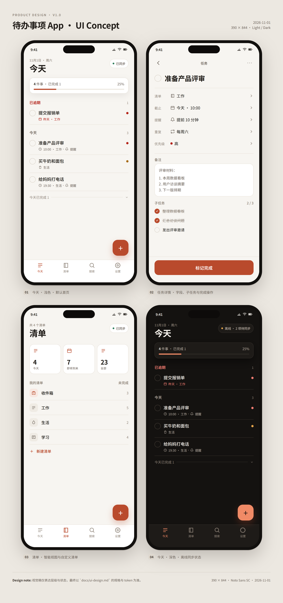
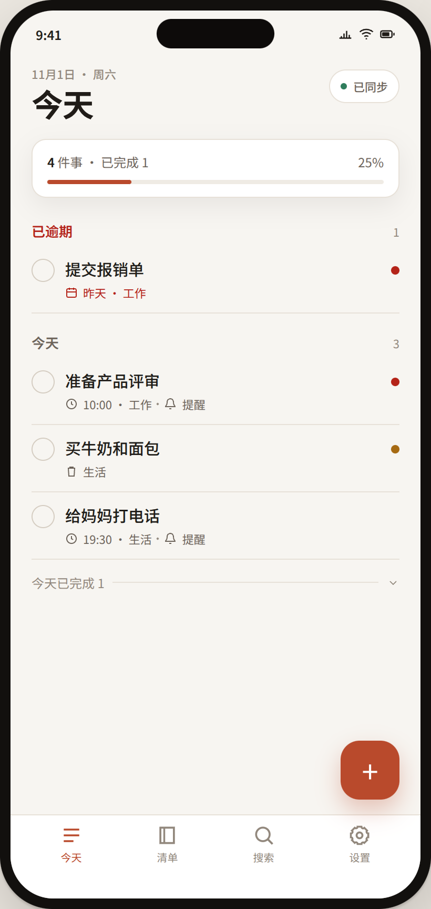
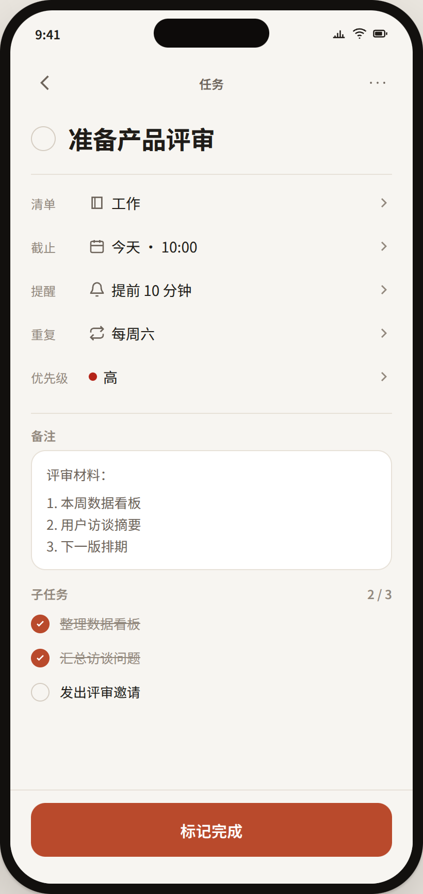
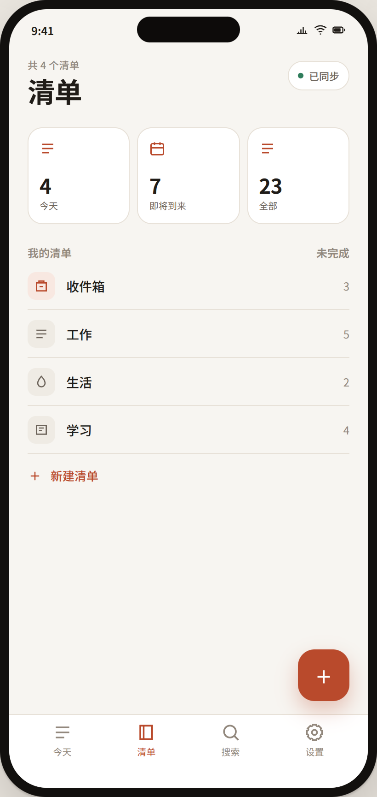
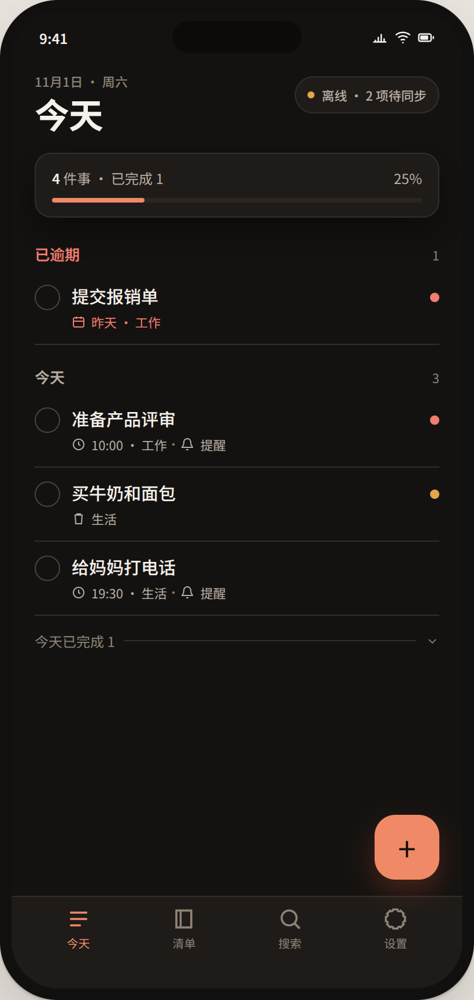

# 待办事项管理 App UI 设计规范

| 项目 | 内容 |
| --- | --- |
| 文档版本 | v1.0 |
| 日期 | 2026-11-01 |
| 状态 | 视觉与交互基线，待设计与研发评审 |
| 平台 | iOS 16+ / Android 9+（Web 预留） |
| 上游文档 | [`todo-app-design.md`](todo-app-design.md)、[`requirements.md`](requirements.md) |
| 设计资产 | [`ui/tokens.json`](ui/tokens.json)、[`ui/mockup.html`](ui/mockup.html)、[`ui/screens/`](ui/screens/) |

> 本文档定义设计原则、token、组件、页面布局、状态与交互。视觉稿为方向稿，像素值以本文档与 `tokens.json` 为准；开发落地时通过设计 token 同步到 React Native 主题。

## 1. 视觉方向

### 1.1 关键词

**安静、温暖、快速、可信。**

- 以暖白纸张色为底，降低长时间使用的视觉疲劳；
- 主色使用低饱和陶土红（coral/terracotta），只用于关键操作与选中态，不铺满界面；
- 信息层级用字号、字重、留白和弱分隔线表达，少用重阴影；
- 不用渐变、玻璃拟态、大面积插画；空状态才使用轻量插画；
- 深色模式不是简单反色，而是降低纯白面积、保持暖色调。

### 1.2 设计原则

1. **今天优先**：打开 App 第一眼看到今天要做的事，而不是项目管理结构。
2. **一屏一事**：每个页面有一个主要动作；次要操作收进菜单/滑动。
3. **本地优先**：离线状态必须可见，但不用红色警告轰炸用户。
4. **手指友好**：所有可点击区域 ≥44×44pt；主要按钮高度 52。
5. **可读**：正文 16pt、行高 24；支持动态字体；对比度达到 WCAG AA。
6. **可预测**：相同组件在浅色/深色、iOS/Android 上保持相同层级与行为。

## 2. 视觉稿总览

| 编号 | 屏幕 | 说明 |
| --- | --- | --- |
| 01 | 今天 · 浅色 | 默认首页，逾期/今天/已完成分组、同步状态、快速新增 |
| 02 | 任务详情 | 字段编辑、备注、子任务、完成操作 |
| 03 | 清单 | 智能视图、自定义清单、计数 |
| 04 | 今天 · 深色 | 深色主题与离线待同步状态 |

单屏文件：

- 
- 
- 
- 

> 视觉稿是 HTML/CSS 渲染的 1:1 方向稿，不是生产代码；最终组件以本文档规格实现。

## 3. 设计 Token

完整值见 [`ui/tokens.json`](ui/tokens.json)。实现时生成 `theme.light` / `theme.dark` 两套对象，禁止在组件里写死颜色。

### 3.1 颜色

| Token | 浅色 | 深色 | 用途 |
| --- | --- | --- | --- |
| background | `#F7F5F1` | `#141210` | 页面底色 |
| surface | `#FFFFFF` | `#1E1B18` | 卡片、输入框、Tab 栏 |
| surfaceMuted | `#EFEBE4` | `#2A2622` | 次级填充、进度槽 |
| surfaceStrong | `#E4DED4` | `#38322C` | 选中/按下态 |
| textPrimary | `#201C18` | `#F5F1EB` | 标题、正文 |
| textSecondary | `#6D645B` | `#B8AEA3` | 元信息、说明 |
| textTertiary | `#92887D` | `#8D8277` | 占位、禁用 |
| border | `#E7E1D8` | `#332E29` | 分隔线、输入边框 |
| accent | `#B94A2C` | `#F08A66` | 主按钮、选中、链接 |
| accentPressed | `#A93E22` | `#FF9E7C` | 按下态 |
| accentSoft | `#F8E8E1` | `#3A241D` | 选中背景、FAB 阴影底 |
| onAccent | `#FFFFFF` | `#1B120E` | 主色上的文字/图标 |
| success | `#2F7D5C` | `#6DB99A` | 已同步、成功 |
| warning | `#A66A12` | `#E5A54B` | 离线、待同步 |
| danger | `#B42318` | `#F27D72` | 逾期、删除 |
| info | `#2F5D8A` | `#8BB8E0` | 提示、链接辅助 |

对比度：

- 浅色正文/底色 15.54:1，次级文字 5.32:1，主色按钮白字 5.15:1；
- 深色正文/底色 16.61:1，次级文字 8.56:1，主色 7.59:1；
- 所有交互元素焦点态使用 `info` 色 2pt 外描边，不能只靠颜色变化。

优先级颜色：高 `danger`、中 `warning`、低/无 `textTertiary`。优先级只用 6–8px 圆点或标签，不做整行染色。

### 3.2 字体

字体栈：`-apple-system, BlinkMacSystemFont, "SF Pro Text", "Roboto", "Noto Sans SC", "PingFang SC", sans-serif`

| Token | 字号/行高 | 字重 | 用途 |
| --- | --- | --- | --- |
| display | 32/38 | 700 | 页面主标题（今天/清单） |
| title | 24/30 | 700 | 任务详情标题 |
| heading | 20/26 | 600 | 分组标题、弹层标题 |
| bodyLarge | 17/26 | 400 | 输入框、长文本 |
| body | 16/24 | 400 | 正文 |
| callout | 15/22 | 400 | 任务标题 |
| label | 13/18 | 500 | 字段标签、按钮小字 |
| caption | 12/16 | 400 | 元信息、计数 |
| overline | 11/14 | 600 | 分组小标题、eyebrow |

规则：

- 动态字体放大至 200% 时，任务行改为多行，不截断关键信息；
- 中文不使用斜体；强调用 600 字重或颜色；
- 长标题最多 2 行，超出省略；详情页标题可 3 行；
- 数字使用 tabular figures（时间、计数）。

### 3.3 间距、圆角、阴影

- 间距基数 4；常用：4/8/12/16/20/24/32；
- 页面左右边距 20；卡片内边距 14–16；列表行最小高度 52；任务行 60–72；
- 圆角：小控件 8、输入/卡片 12–16、FAB 18、弹层 28、头像/复选 999；
- 阴影：卡片 `0 8px 24px rgba(32,28,24,.08)`；深色用 `0 12px 32px rgba(0,0,0,.45)`；避免多层阴影；
- 分隔线 1px，仅用于列表行之间，不用于每个区块。

### 3.4 布局

| 项 | 值 |
| --- | --- |
| 设计宽度 | 390pt（iPhone 14/15 基准） |
| 内容边距 | 20pt |
| 状态栏 | 44pt（由系统安全区决定） |
| 导航栏 | 52pt |
| Tab 栏 | 64pt + 底部安全区 |
| FAB | 56×56，右 20 / 底 80 |
| 最小触控 | 44×44 |
| 平板/横屏 | 内容最大宽度 680，居中；列表可双栏（P2） |

安全区：顶部用 `useSafeAreaInsets`，底部 Tab 栏加 `paddingBottom: max(insets.bottom, 16)`；键盘弹出时输入区上推，Tab 栏隐藏。

## 4. 组件规范

### 4.1 按钮

| 类型 | 高度 | 背景 | 文字 | 使用场景 |
| --- | --- | --- | --- | --- |
| Primary | 52 | accent | onAccent | 完成、保存、登录 |
| Secondary | 44 | surfaceMuted | textPrimary | 次要操作 |
| Tertiary/Text | 44 | 透明 | accent | 跳过、了解更多 |
| Destructive | 44/52 | danger（确认后） | white/onAccent | 删除、注销 |
| Icon | 44×44 | 透明/圆角 10 | textSecondary | 返回、更多、关闭 |

状态：默认 / 按下（scale 0.98 + 深色）/ 禁用（40% 透明度）/ 加载（12pt 转圈，保留宽度）/ 焦点（2pt info 描边）。

### 4.2 输入框与表单

- 高度 44；圆角 12；背景 surface；边框 1px border；聚焦边框 accent；
- 标题输入无边框，字号 24/30，占位“要做点什么？”；
- 错误状态：边框 danger + 下方 12pt 错误文案；错误文案与字段通过 `accessibilityHint` 关联；
- 字数限制在接近上限时显示 `N/500`，超过截断并提示；
- 键盘类型：邮箱 `email-address`，验证码 `number-pad`，标题默认文本；
- 自动保存（P1）在停止输入 800ms 后触发；MVP 显式保存。

### 4.3 任务行

结构（从左到右）：

1. 复选框：22×22 视觉，44×44 触控；未完成空心、完成实心 accent + 勾；
2. 内容区：标题 15/22（最多 2 行）+ 元信息 11/16；
3. 优先级圆点 8px（可选）；
4. 右侧滑动操作（仅手势）：完成 / 延期 / 删除。

元信息顺序：时间 → 清单 → 提醒 → 重复 → 子任务进度。逾期用 danger 色并加“昨天/逾期 2 天”。已完成任务标题加删除线并降低对比度。

状态：默认 / 按下（surfaceMuted）/ 选中（批量模式）/ 完成 / 禁用（同步冲突标记）。

### 4.4 复选框与进度

- 圆形 22；点击切换；触控 44；
- 子任务使用 18px，不做独立触控放大（整行可点）；
- 父任务显示“2/3”时，若全部完成则勾选父任务？**不自动完成**，由用户确认；进度用 2/3 文本，不画环。

### 4.5 清单行

- 高度 52；图标 30×30 圆角 9；名称 14/20；右侧计数 12；
- 收件箱使用 accentSoft 图标；自定义清单图标底色由清单颜色 12% 透明度生成；
- 长按进入编辑菜单（重命名/改色/归档/删除）。

### 4.6 智能视图卡片

- 3 列等宽，间距 8；高度 ≥88；圆角 16；
- 图标 18、数字 22/26 700、说明 10；
- 点击进入筛选视图；卡片不显示进度环，避免与今天重复。

### 4.7 FAB

- 56×56，圆角 18，accent 背景，白色“+”；阴影 accent 30%；
- 位于 Tab 栏上方 16；点击打开快速新增（默认聚焦标题）；
- 键盘弹出时上移到键盘上方 16；列表滚动时保持可见，不自动隐藏。

### 4.8 Tab 栏

- 4 个 Tab：今天、清单、搜索、设置；图标 22、文字 10；
- 激活色 accent，未激活 textTertiary；
- 高度 64 + 安全区；顶部 1px border；
- 点击已激活 Tab：滚动到顶部（今天/清单）；搜索 Tab 聚焦输入框。

### 4.9 同步状态

| 状态 | 文案 | 颜色 | 位置 |
| --- | --- | --- | --- |
| 已同步 | 已同步 | success | 标题右侧 pill |
| 同步中 | 同步中 | textSecondary + 旋转 | pill |
| 离线 | 离线 | warning | pill |
| 待同步 | 离线 · N 项待同步 | warning | pill |
| 冲突 | 有冲突 | danger | pill + 任务标记 |
| 失败 | 同步失败 · 重试 | danger | pill，可点击 |

pill：高 26，圆角 999，surface 背景，1px border；小屏可只显示图标+数字。

### 4.10 空状态、加载、错误

- 空状态：48–64px 线性图标/轻插画 + 标题 16/600 + 说明 13 + 主按钮；
- 加载：首屏骨架屏（任务行灰块），不做全屏 spinner；同步中仅 pill 动画；
- 错误：页面级错误用内联卡片（图标 + 文案 + 重试），不用 Alert；
- 离线：顶部不占位横幅，仅 pill；写入失败时才出现可关闭提示。

### 4.11 日期、重复、提醒选择器

- 日期：底部 sheet；快捷项（今天/明天/下周一/自定义）；日期 + 时间两个 tab；
- 全天开关：默认关闭；开启后隐藏时间选择；
- 重复：频率 segmented（每天/每周/每月/每年）+ 间隔 stepper + 星期选择 + 结束条件（永不/日期/次数）；
- 提醒：列表多选，最多 5 个；快捷偏移 chips；自定义偏移 stepper；全天任务显示“当天 09:00”基准；
- 所有 sheet 顶部有拖拽条，背景遮罩 40% 黑；关闭按钮 44。

### 4.12 弹层与 Toast

- 底部 sheet：圆角 28 顶部；最大高度 90%；内容可滚动；
- 确认对话框：标题 17/600、说明 13、按钮纵向排列（危险操作在主位且为 danger）；
- Toast：底部 Tab 上方，surface 反色/深色，圆角 12，4 秒自动消失；Undo 按钮最多 5 秒；
- 不堆叠多个 Toast；同类型合并。

### 4.13 冲突与离线提示

- 冲突任务：标题右侧 8px danger 圆点 + 元信息“已合并冲突”；
- 点击进入冲突详情（P1）：字段、服务端值、我的修改；主按钮“使用服务端版本”，次按钮“重新编辑”；
- 离线：只改变 pill，不改变页面结构；用户仍可创建/编辑/完成；
- 同步失败：pill 点击打开“同步诊断”（P1），显示最后同步时间与重试。

## 5. 页面规格

### 5.1 启动与登录

流程：

1. 启动（品牌 + 一句价值主张，≤1.2 秒跳过）；
2. 登录页：标题“继续你的待办”，说明；邮箱输入 + “发送验证码”；分隔线“或”；Apple 按钮（黑底）/ Google（白底描边）；
3. 验证码页：6 个输入格、自动聚焦、粘贴支持；重发倒计时 60 秒；
4. 通知权限页：说明“到点提醒你”，按钮“开启提醒”/“稍后”；
5. 首次任务引导（可选）：输入框 + “开始使用”。

状态：

- 邮箱格式错误：输入框下方提示，按钮禁用；
- 验证码错误：格子抖动 + 文案“验证码不正确或已过期”；
- 网络错误：Toast + 保留输入；
- Apple 隐藏邮箱：登录后提示“已使用 Apple 私密邮箱，可在设置中绑定其他登录方式”（P1）。

### 5.2 今天

布局（自上而下）：

1. 状态栏 + 顶部栏 52：左侧日期 eyebrow + “今天” display；右侧同步 pill；
2. 完成摘要卡片：4 件事 · 已完成 1、进度条 25%；
3. 内容滚动：
   - 已逾期（danger 标题 + 计数）；任务行；
   - 今天（标题 + 计数）；任务行；
   - 今天已完成（折叠行，点击展开）；
4. FAB；
5. Tab 栏。

交互：

- 点击复选框完成/取消；完成时任务短暂高亮后移除（250ms），撤销 Toast 5 秒；
- 点击任务进入详情；长按进入多选（P1）；
- 左滑：删除（danger）；右滑：完成（accent）；滑动阈值 72，触觉反馈；
- 下拉刷新触发同步；无网络时显示“离线”并保留本地数据；
- 跨午夜：前台每 60 秒检查日期，刷新分组并提示“新的一天”；
- 空状态：“今天没有安排” + “添加任务” + 可选“从收件箱挑一件”。

验收：

- 超长标题 2 行截断；动态字体 200% 不重叠；
- 完成动画不超过 280ms；撤销期间任务可恢复；
- 离线创建后立即出现在今天（若日期匹配）。

### 5.3 清单

布局：

1. 顶部“清单” + 同步；
2. 智能视图 3 卡：今天、即将到来、全部；
3. “我的清单”列表：收件箱、自定义清单 + 计数；
4. “新建清单”行；
5. FAB、Tab 栏。

交互：

- 点击智能视图进入筛选列表（今天为 Tab 首页，不重复进入）；
- 点击清单进入清单详情：分组（逾期/今天/之后/无日期），顶部计数，支持排序切换；
- 长按清单：重命名、改色、归档、删除；删除时底部 sheet 选择任务去向；
- 新建清单：名称、颜色（12 色）、图标（24 个）、保存；
- 空状态：“还没有自定义清单” + “新建清单”。

### 5.4 清单详情

- 导航：返回、清单名（可编辑）、更多（排序/归档/删除）；
- 头部：未完成计数 + 进度；
- 分组标题 + 任务行；默认隐藏已完成，底部“显示已完成”；
- 批量模式：长按进入，多选后底部操作条（完成/移动/删除）；
- 拖拽排序：长按拖动，行抬起 1.02 阴影；松手保存 `sortRank`；
- 空状态：“这个清单是空的” + “添加任务”。

### 5.5 任务详情

布局：

1. 导航 52：返回、标题“任务”、更多；
2. 标题行：复选框 24 + 标题 24/32（最多 3 行）；
3. 字段区：
   - 清单（点击选择）
   - 截止（日期 + 时间；全天开关）
   - 提醒（chips / 编辑）
   - 重复（摘要，点击编辑）
   - 优先级（选择）
   - 标签（P1）
4. 备注：Markdown 编辑/预览切换；空状态“添加备注”；
5. 子任务：列表 + “添加子任务”；进度 2/3；
6. 附件（P1）：缩略图网格 + 添加；
7. 底部主按钮“标记完成”（重复任务为“完成本次”）。

交互：

- 点击字段打开对应 sheet；修改立即保存（本地 + outbox）；
- 完成：一次性 → 勾选 + 底部按钮变“已完成”；重复 → 推进实例并显示“已完成本次，下一次：11月9日”；
- 5 秒撤销 Toast；重复任务按 completionId 恢复；
- 删除：导航更多 → 删除 → 确认 → 回收站；
- 键盘：备注编辑时底部按钮隐藏，键盘上方工具栏（完成/列表/链接）；
- 冲突：字段右侧显示“已合并”标记，点击查看（P1）。

验收：

- 输入标题时实时保存草稿（P1）；MVP 返回时提示未保存；
- 修改到期时间后提醒摘要同步更新；
- 重复任务完成后日期与提醒正确刷新。

### 5.6 搜索

布局：

1. 顶部搜索框：圆角 12，图标 + 输入 + 清除；
2. 未输入：最近搜索（最多 10 条，可清除）；
3. 输入中：结果列表按清单分组；结果行高亮关键词；
4. 无结果：空状态“没有找到相关任务” + 清除筛选；
5. 过滤（P1）：清单/标签/优先级/状态底部 sheet；已选条件 chips。

交互：

- 输入 200ms 防抖；中文 2 字开始搜索；
- 搜索本地数据，无网可用；
- 点击结果进入详情；返回保留关键词与滚动位置；
- 搜索历史仅本地；左滑删除单条。

### 5.7 设置

分组：

1. 账户：头像、昵称、邮箱、设备管理、退出登录；
2. 外观：主题（跟随系统/浅色/深色）、强调色、触感反馈；
3. 行为：周起始、默认清单、默认提醒时间、24 小时制、默认优先级；
4. 通知：权限状态、提醒开关、免打扰、每日摘要（P1）；
5. 数据：导出 JSON/CSV、导入（P1）、清除已完成、清空回收站、注销账号；
6. 关于：版本、隐私政策、用户协议、开源许可、同步诊断（P1）。

布局：分组列表行高 52，右侧值 + chevron；危险操作使用 danger 文本，放在最底部；注销流程见需求文档。

### 5.8 回收站

- 导航返回 + “回收站”；说明“保留 30 天”；
- 任务行：标题、删除时间、剩余天数；右侧“恢复”；
- 空状态：“回收站是空的”；
- 底部“清空回收站”危险操作，二次确认。

### 5.9 同步冲突（P1）

- 页面/Sheet：任务标题、冲突字段列表；
- 每个字段显示“服务端版本 / 我的版本”，默认选中服务端；
- 主按钮“保留服务端并关闭”，次按钮“重新编辑”；
- 关闭后任务标记消失；不丢服务端数据。

### 5.10 通知（系统层）

- 标题：任务标题；正文：清单名 · 时间；
- 点击深链任务；任务不存在 → 今天 + Toast；
- 操作（P1）：完成、稍后 10 分钟、明天；
- 通知分组：按任务 ID；多提醒折叠；
- 免打扰：仅影响摘要/协作，不影响显式提醒。

## 6. 交互与动效

| 交互 | 规范 |
| --- | --- |
| 页面进入 | 右滑入 280ms，ease-out；返回反向 |
| 任务完成 | 勾选 120ms，行高亮 200ms 后移除；可撤销 |
| 删除 | 左滑露出 danger；松手 200ms 移除；Toast 撤销 |
| 底部 Sheet | 上滑 280ms + 背景淡入；下拉关闭 |
| FAB | 按下 scale 0.96；打开 composer 时旋转 45° 变关闭 |
| 拖拽排序 | 长按 300ms 抬起；1.02 缩放；触觉轻震 |
| 同步 pill | 旋转 1s 循环；成功后 2s 恢复静态 |
| 冲突 | 圆点脉冲 2 次后停止，避免长期闪烁 |
| 减少动效 | 系统开启“减少动态效果”时移除位移/缩放，仅保留淡入 |

触觉：

- 完成任务：light impact；
- 删除/危险操作：medium impact；
- 拖拽开始/放置：selection；
- 错误：notification warning（仅重要错误）。

## 7. 无障碍

- 触控目标 ≥44×44；任务复选框视觉 22，热区 44；
- 所有图标按钮有 `accessibilityLabel`；图片有 `alt`；
- 动态字体：支持到 200%，布局改为多行；禁止固定行高；
- 读屏顺序：页面标题 → 同步状态 → 分组标题 → 任务标题 → 元信息 → 复选框；
- 颜色对比：正文/次级文字均达 AA；危险/成功状态同时有文字，不只靠颜色；
- 焦点态：2pt info 描边，不仅改变颜色；
- 键盘导航（Web P2）：Tab 顺序与视觉一致；
- 动效：尊重 reduce motion；动画不超过 280ms；
- 表单错误：读屏播报错误文案；
- 语言：中文/英文；所有文案可本地化，避免拼接句子。

## 8. 文案规范

- 语气：简短、具体、不制造焦虑；不用“失败”“错误”作为标题，优先说明下一步；
- 按钮用动词：“添加任务”“标记完成”“稍后提醒”“删除账号”；
- 空状态：一句事实 + 一个动作；
- 危险确认：说明后果与可恢复性（“删除后可在回收站保留 30 天”）；
- 时间：今天/明天/昨天；超过 7 天用“11月9日”；时间用 24h/12h 跟随设置；
- 计数：中文“4 件事”，英文“4 tasks”；
- 同步：“已同步”“离线 · 2 项待同步”，不显示技术术语（seq、outbox）。

## 9. 设计交付与实现

### 9.1 资产

| 资产 | 路径 | 说明 |
| --- | --- | --- |
| 设计 token | [`ui/tokens.json`](ui/tokens.json) | 颜色/字体/间距/圆角/动效 |
| 视觉稿 | [`ui/mockup.html`](ui/mockup.html) | 4 屏 1:1 HTML/CSS 方向稿 |
| 截图 | [`ui/screens/`](ui/screens/) | PR/评审用 PNG |
| 图标 | 待设计 | 统一 24px 线性图标，1.8px 描边 |

### 9.2 组件映射

| 设计组件 | 客户端实现 | 说明 |
| --- | --- | --- |
| Button | `Button`（variant/size/loading） | 不直接用 Pressable 写样式 |
| TaskRow | `TaskRow` | 订阅 task 变更；支持 swipe |
| Checkbox | `TaskCheckbox` | 视觉 22 / 热区 44 |
| SyncPill | `SyncStatusPill` | 订阅 sync store |
| BottomSheet | `Sheet` | 统一圆角/遮罩/拖拽 |
| DatePicker | `DueDateSheet` | 日期/时间/全天 |
| RecurrenceSheet | `RecurrenceSheet` | RRULE 子集 |
| ReminderSheet | `ReminderSheet` | 最多 5 个 |
| EmptyState | `EmptyState` | 图标/标题/说明/按钮 |
| Toast | `Toast` | 5 秒撤销 |

### 9.3 实现验收

- [ ] 浅色/深色两套 token 完整，组件无硬编码颜色；
- [ ] 390pt 宽度下无横向滚动；动态字体 200% 不截断关键操作；
- [ ] 所有触控目标 ≥44×44；
- [ ] 任务行/详情/设置三处复选框状态一致；
- [ ] 离线/同步中/冲突状态在视觉稿对应位置出现；
- [ ] 动效时长与 reduce motion 生效；
- [ ] VoiceOver/TalkBack 可完成“创建→完成→删除→恢复”；
- [ ] 中英文文案无溢出；
- [ ] 截图与最终实现对比，差异有记录。

## 10. 待确认

| 问题 | 影响 | 默认 |
| --- | --- | --- |
| 品牌色是否采用陶土红？ | 全局视觉 | 是 |
| 是否使用自定义字体？ | 品牌/包体 | 系统字体 + Noto Sans SC 回退 |
| 是否支持 iPad/横屏？ | 布局 | MVP 仅手机竖屏 |
| 是否支持桌面小组件？ | P2 | P2 |
| 是否提供 Figma 源文件？ | 交接 | 以 tokens + HTML 为准，后续补 Figma |
